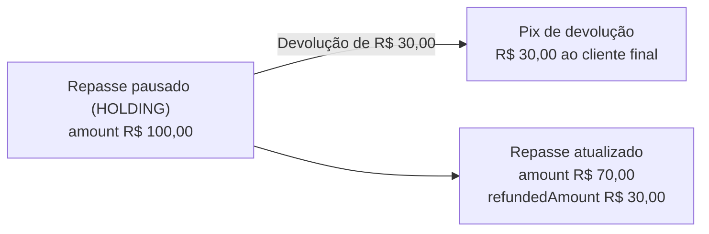

<Warning>
**Funcionalidade em beta.** Contrato em proposta, sujeito a mudanças. Veja o guia [Acompanhar repasses](/guias/split-pagamentos/acompanhar-repasses).
</Warning>

Cria uma **devolução** (*refund*) de parte do valor de um repasse (*payout*). A devolução faz duas coisas:

1. Envia um Pix de devolução ao cliente final (o pagador), vinculado ao Pix original da ordem de recebimento com split. O valor sai da conta de recebimento.
2. Desconta o valor devolvido do repasse: o `amount` do repasse diminui e o `refundedAmount` aumenta.

Use quando uma venda precisa ser desfeita em parte antes de o beneficiário receber. Por exemplo, em uma disputa em que o cliente final devolve um dos produtos do pedido.



## Quando é possível devolver

| Regra | Detalhe |
|---|---|
| Status do repasse | Só `HOLDING`. Antes de devolver, [pause o repasse](/api-reference/split-pagamentos/atualizar-repasse) com `HOLD` |
| Valor | Maior que zero e até o `amount` atual do repasse |
| Prazo | Até 90 dias depois do Pix original, que é o limite do Pix para devoluções |
| Quantidade | Você pode fazer várias devoluções no mesmo repasse, até devolver o valor todo |

Quando a soma das devoluções concluídas chega ao valor original do repasse, o repasse vai para `REFUNDED` e não é mais executado. Enquanto sobra algum valor, o repasse continua em `HOLDING`. Depois de liberado, ele é executado com o valor restante.

<Note>
Depois que o repasse é concluído (`SUCCESS`), não é possível devolver por esta rota, porque o dinheiro já está na conta do beneficiário. Nesse caso, a conta de recebimento ainda pode devolver o Pix original ao cliente final, mas o valor sai do caixa do marketplace, sem desconto no repasse.
</Note>

<Note>
A devolução exige o repasse pausado. Em uma disputa, o fluxo é:

1. [Pause o repasse](/api-reference/split-pagamentos/atualizar-repasse) com `HOLD`. Só repasses em `SCHEDULED` podem ser pausados, então agende os repasses que podem ter disputa (`daysUntilPayment` ou `paymentDate`).
2. Devolva o valor acordado com esta rota. Pode haver mais de uma devolução.
3. [Libere o repasse](/api-reference/split-pagamentos/atualizar-repasse) com `RELEASE`, para o beneficiário receber o restante, ou cancele com `CANCEL`.

Enquanto o repasse está em `HOLDING`, ele não é executado, nem na data prevista.
</Note>

## Headers

<ParamField header="x-delbank-api-key" type="string" required>
  Sua API key.
</ParamField>

<ParamField header="x-delfinance-account-id" type="string" required>
  Número da conta de recebimento.
</ParamField>

## Path params

<ParamField path="payoutId" type="string" required>
  Identificador do repasse (`id`), obtido em [Listar repasses](/api-reference/split-pagamentos/listar-repasses) ou em [Consultar ordem de recebimento com split](/api-reference/split-pagamentos/consultar-recebimento).
</ParamField>

## Body

<ParamField body="amount" type="number" required>
  Valor a devolver, em reais. Deve ser maior que zero e no máximo igual ao `amount` atual do repasse.
</ParamField>

<ParamField body="reason" type="string">
  Motivo da devolução. Até 200 caracteres. Também é enviado como descrição do Pix de devolução.
</ParamField>

<ParamField body="requestedBy" type="string">
  Nome ou identificação de quem pediu a devolução, por exemplo, o usuário ou a área da sua plataforma. Até 50 caracteres. Se não for informado, a API registra `Não informado.`
</ParamField>

## Response

Retorna `201 Created` com a devolução criada, em `PROCESSING`. O Pix de devolução é processado de forma assíncrona: acompanhe o resultado em [Listar devoluções de um repasse](/api-reference/split-pagamentos/listar-devolucoes-repasse).

O valor é descontado do repasse assim que a devolução é criada. Se a devolução terminar em `ERROR`, o valor volta para o `amount` do repasse.

<ResponseField name="id" type="string">
  Identificador da devolução.
</ResponseField>
<ResponseField name="payoutId" type="string">
  Identificador do repasse.
</ResponseField>
<ResponseField name="amount" type="number">
  Valor devolvido, em reais.
</ResponseField>
<ResponseField name="status" type="object">
  Status da devolução, como enum (`name`, `description` e `value`). `name`: `PROCESSING` (Pix de devolução enviado, aguardando confirmação), `SUCCESS` (valor devolvido ao cliente final) ou `ERROR` (devolução não concluída; o valor volta para o repasse).
</ResponseField>
<ResponseField name="reason" type="string">
  Motivo informado.
</ResponseField>
<ResponseField name="requestedBy" type="string">
  Quem pediu a devolução.
</ResponseField>
<ResponseField name="transactionId" type="string">
  Id da transação de devolução no extrato da conta de recebimento.
</ResponseField>
<ResponseField name="endToEndId" type="string">
  Identificador do Pix de devolução. Pode vir `null` enquanto a devolução está em `PROCESSING`.
</ResponseField>
<ResponseField name="errorMessage" type="string">
  Motivo da falha, quando o status é `ERROR`.
</ResponseField>
<ResponseField name="createdAt" type="string">
  Data e hora da criação da devolução, em ISO 8601.
</ResponseField>
<ResponseField name="updatedAt" type="string">
  Data e hora da última mudança de status, em ISO 8601.
</ResponseField>

## Erros

| HTTP | Código | Quando acontece |
|---|---|---|
| `400` | `VALIDATION_ERROR` | `amount` ausente, menor ou igual a zero, ou maior que o `amount` atual do repasse |
| `404` | `SPLIT_PAYOUT_NOT_FOUND` | Não existe repasse com esse `payoutId` na conta de recebimento |
| `422` | `SPLIT_PAYOUT_NOT_REFUNDABLE` | O repasse não está em `HOLDING`, ou o Pix original passou do prazo de 90 dias |
| `422` | `INSUFFICIENT_BALANCE` | A conta de recebimento não tem saldo para o Pix de devolução |

<RequestExample>
```bash cURL
curl --location 'https://apisandbox.delbank.com.br/baas/api/v1/split-payments/payouts/3f9b2c7e-8d14-4b6a-a0e5-71c2d9f4b8a3/refunds' \
--header 'Content-Type: application/json' \
--header 'x-delbank-api-key: {{apiKey}}' \
--header 'x-delfinance-account-id: {{accountId}}' \
--data '{
    "amount": 30.00,
    "reason": "Devolução de 1 item do pedido 4821",
    "requestedBy": "Equipe financeira"
}'
```
</RequestExample>

<ResponseExample>
```json 201
{
    "id": "9a7b6c5d-4e3f-4a2b-8c1d-0e9f8a7b6c5d",
    "payoutId": "3f9b2c7e-8d14-4b6a-a0e5-71c2d9f4b8a3",
    "amount": 30.00,
    "status": {
        "name": "PROCESSING",
        "description": "Processando",
        "value": 0
    },
    "reason": "Devolução de 1 item do pedido 4821",
    "requestedBy": "Equipe financeira",
    "transactionId": "d4c3b2a1-f6e5-4d7c-9b8a-7f6e5d4c3b2a",
    "endToEndId": null,
    "errorMessage": null,
    "createdAt": "2026-11-03T13:05:00.000Z",
    "updatedAt": null
}
```

```json 422
{
    "code": "SPLIT_PAYOUT_NOT_REFUNDABLE",
    "message": "O repasse está em SUCCESS e não pode ter devoluções."
}
```
</ResponseExample>
