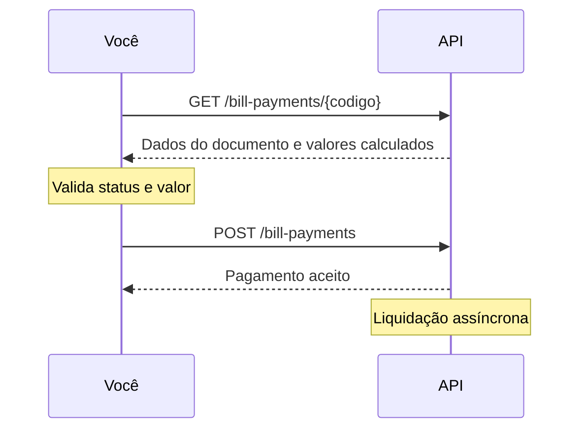

Com a API de pagamento de contas, você paga a partir da sua conta Delfinance:

- **Boletos bancários** — emitidos por qualquer banco
- **Contas de consumo** — água, luz, gás, telefone, internet
- **Tributos** — IPTU, ISS, IPVA, DAS, multas de trânsito

Você informa o código de barras ou a linha digitável. A API identifica o tipo do documento e calcula o valor a pagar.

## Como funciona o fluxo

O pagamento acontece em duas chamadas: primeiro você consulta o documento, depois paga.

1. **Consulte** o documento pelo código de barras ou linha digitável.
2. **Valide** no seu sistema se o documento pode ser pago e qual valor enviar.
3. **Pague** informando o valor e o código de barras ou a linha digitável.

<Warning>
O pagamento é **assíncrono**. A resposta do `POST /bill-payments` indica que o pagamento foi aceito para processamento, não que já foi liquidado. Hoje não há webhook de confirmação. Se o pagamento não for liquidado, o valor volta para a sua conta e o time da Delfinance entra em contato.
</Warning>

## Boleto ou conta de consumo/tributo

A linha digitável mostra o tipo do documento. Use estas regras se o seu sistema precisa tratar os dois tipos de forma diferente:

| | Boleto bancário | Conta de consumo ou tributo |
|---|---|---|
| Tamanho da linha digitável | 47 dígitos | 48 dígitos |
| Primeiro dígito | De `0` a `7` | Sempre `8` |
| O que os primeiros dígitos indicam | Os 3 primeiros são o código do banco emissor | O 2º dígito é o segmento do documento |
| `type` retornado na consulta | `BANKSLIP` | `TAXES` |

Para contas de consumo e tributos, o segundo dígito indica o segmento, conforme o padrão Febraban:

| Início | Segmento | Exemplos |
|---|---|---|
| `81` | Prefeituras | IPTU, ISS, taxas municipais |
| `82` | Saneamento | Água e esgoto |
| `83` | Energia elétrica e gás | Conta de luz, conta de gás |
| `84` | Telecomunicações | Telefone, internet, TV por assinatura |
| `85` | Órgãos governamentais | IPVA, DAS do Simples Nacional |
| `86` | Carnês e outros | Varia conforme o convênio |
| `87` | Multas de trânsito | Multas |

<Note>
A Delfinance não publica uma lista fixa de convênios aceitos, porque ela muda com frequência. Para saber se um documento pode ser pago, faça a consulta: ela retorna o `status` do documento. Em caso de dúvida sobre um convênio específico, fale com o [suporte](mailto:suporte@Delfinance.com.br).
</Note>

## Horários de processamento

Os horários são de Brasília.

| Tipo de documento | Horário limite |
|---|---|
| Boletos bancários | Até 20h |
| Contas de consumo e tributos | Até 16h |

## Limites de valor para contas de consumo e tributos

O valor máximo por transação depende do momento em que o pagamento é processado:

| Quando o pagamento é processado | Valor máximo por transação |
|---|---|
| Dias úteis, das 7h às 16h30 | R$ 1.400.000,00 |
| Dias úteis antes das 7h ou depois das 16h30, e dias não úteis | R$ 999.999,00 |

Os pagamentos também respeitam o limite de pagamentos configurado na sua conta.

## Status do documento

A consulta retorna o `status` do documento. Só pague documentos com status `PENDING_PAYMENT`.

| Status | Significado | Pode pagar? |
|---|---|---|
| `PENDING_PAYMENT` | Documento aguardando pagamento | Sim |
| `PAID` | Documento já pago | Não |
| `BLOCKED_PAYMENT` | Pagamento bloqueado pelo emissor | Não |
| `PAYMENT_DEADLINE_EXCEEDED` | Prazo limite para pagamento ultrapassado | Não |

## Testar no sandbox

Para testar o fluxo completo, emita um boleto pela [API de cobrança](/guias/boleto/emitir-boleto) e use o `barCode` ou a `digitableLine` retornados para consultar e pagar.

## Próximos passos

<CardGroup cols={2}>
  <Card title="Consultar boleto ou conta" icon="magnifying-glass" href="/guias/pagamento-contas/consultar">
    Consulte os dados e os valores de um documento antes de pagar.
  </Card>
  <Card title="Pagar" icon="paper-plane" href="/guias/pagamento-contas/pagar">
    Pague um boleto, conta de consumo ou tributo.
  </Card>
</CardGroup>
