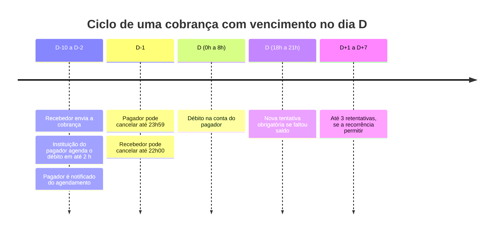

O Pix Automático segue prazos fixados pelo Banco Central. Eles valem para todas as instituições, e a sua integração precisa respeitá-los: uma cobrança enviada fora da janela é rejeitada pela instituição do pagador.

Todos os horários são de **Brasília**.

## Visão geral do ciclo de uma cobrança

## Autorização

| Regra | Prazo |
|---|---|
| Validade da solicitação de autorização ([jornada 1](/guias/pix/pix-automatico/visao-geral#jornadas-de-autorização)) | Até **30 dias** após o envio. Você pode definir um prazo menor |
| Reenvio da mesma oferta a quem não autorizou | Evite reenviar em menos de **30 dias**. O Banco Central considera envio excessivo |
| Recebedor | Precisa ser **pessoa jurídica** com CNPJ ativo há pelo menos **6 meses** |

## Envio da cobrança

| Regra | Prazo |
|---|---|
| Envio de cada cobrança | Entre **10 e 2 dias corridos** antes do vencimento. A Delfinance faz esse envio automaticamente |
| Agendamento pela instituição do pagador | Até **2 horas** após receber a cobrança |
| Cobranças por ciclo | **Uma** por ciclo da recorrência. Exemplo: mensal a partir de 15/07 tem ciclos de 15 a 14 |
| Valor | Se a recorrência tem valor fixo, a cobrança precisa ter **exatamente** esse valor |
| Vencimento em dia não útil | O débito passa para o próximo dia útil, considerando os feriados do município do pagador |

<Note>
O pagamento nunca é antecipado. O vencimento pode ser adiado dentro do mesmo ciclo, mas não pode ir para antes da data informada.
</Note>

## Débito na conta do pagador

| Regra | Horário |
|---|---|
| Débito no dia do vencimento | Entre **0h e 8h** |
| Sem saldo ou sem limite às 8h | O pagador é notificado, e a instituição faz **pelo menos uma nova tentativa entre 18h e 21h** do mesmo dia |
| Última tentativa do dia | Até **21h** |

Se o débito falhar nas tentativas do dia, a autorização **continua ativa**. As próximas cobranças seguem normalmente.

## Retentativas após o vencimento

As retentativas só existem quando a recorrência foi criada com `retry` igual a `ALLOWED`. Essa escolha é do recebedor e não pode ser alterada depois.

| `retry` | Comportamento |
|---|---|
| `NOT_ALLOWED` | Sem retentativas. Se o débito falhar, o pagador precisa pagar por outro meio |
| `ALLOWED` | Até **3 retentativas**, em **dias diferentes**, em até **7 dias corridos** após o vencimento original, sempre com o mesmo valor |

Uma retentativa precisa chegar à instituição do pagador até 23h59 do dia anterior e segue as mesmas janelas de débito (0h a 8h e 18h a 21h). Ela não pode passar do dia anterior ao próximo ciclo nem da data final da recorrência.

<Note>
Hoje, a Delfinance não envia retentativas após o vencimento, mesmo com `retry` igual a `ALLOWED`. A nova tentativa do mesmo dia, entre 18h e 21h, é feita pela instituição do pagador e acontece normalmente.
</Note>

## Cancelamentos

| Quem cancela | O quê | Até quando | Efeito |
|---|---|---|---|
| Pagador | Um débito agendado | **23h59 do dia anterior** ao vencimento | Só aquele débito. A autorização continua. Retentativas não podem ser canceladas |
| Recebedor | Uma cobrança enviada | **22h00 do dia anterior** ao vencimento | Só aquela cobrança. Retentativas não podem ser canceladas |
| Pagador | A autorização inteira | A qualquer momento | Cancela os débitos agendados **a partir do dia seguinte**. Os do próprio dia são mantidos |
| Recebedor | A recorrência inteira | A qualquer momento | Cancela os débitos a partir do dia seguinte. Se o pedido chegar entre 22h e 23h59, a partir de dois dias depois |

## Direitos do pagador

O app do pagador deve permitir que ele:

- defina e altere um **valor máximo** para recorrências de valor variável. Uma cobrança acima desse valor não é agendada, e o pagador é avisado;
- cancele a autorização ou um débito agendado, nos prazos acima;
- veja as autorizações pendentes, ativas e o histórico de débitos;
- desative a notificação de agendamento bem-sucedido.

O valor máximo fica só na instituição do pagador. **O recebedor não vê esse valor.**

<Warning>
É proibido cobrar tarifa do pagador pelo uso do Pix Automático.
</Warning>

## Fontes

- [Guia de implementação do Pix Automático](https://www.bcb.gov.br/content/estabilidadefinanceira/pix/automatico/guia_pix_automatico.pdf), Banco Central
- [FAQ Pix Automático para participantes](https://www.bcb.gov.br/content/estabilidadefinanceira/pix/pix-automatico-FAQ-participantes.pdf), Banco Central
- [Instrução Normativa BCB nº 513/2024](https://www.bcb.gov.br/api/conteudo/app/normativos/exibenormativo?p1=Instru%C3%A7%C3%A3o%20Normativa%20BCB&p2=513), arts. 3º a 9º
