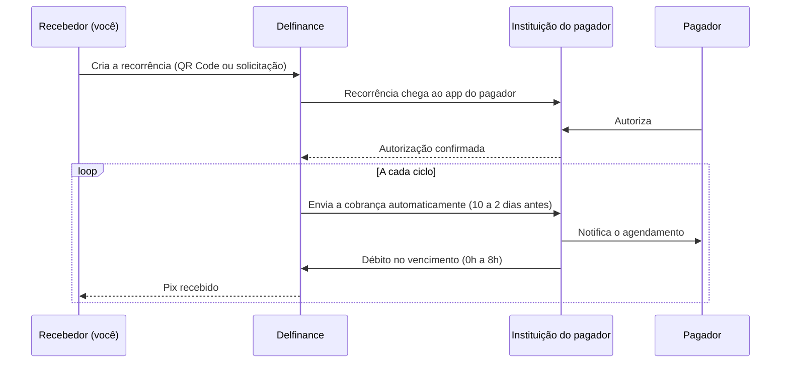

<Warning>
O Pix Automático está em **beta**. As rotas, os campos e o comportamento podem mudar. Teste em Sandbox antes de usar em produção.
</Warning>

O **Pix Automático** permite cobrar um cliente de forma recorrente, como em assinaturas, mensalidades e contas de consumo. O cliente autoriza **uma vez** no app do banco dele. Depois disso, cada cobrança é debitada automaticamente no vencimento, sem que ele precise aprovar de novo.

Para quem recebe, funciona como um débito automático: menos inadimplência por esquecimento e nenhum custo de boleto. Para quem paga, o controle fica no app do banco: ele vê os agendamentos, define um valor máximo e cancela quando quiser.

## Conceitos

| Termo | O que é |
|---|---|
| **Recebedor** | A empresa que cobra. Precisa ser pessoa jurídica, com CNPJ ativo há pelo menos 6 meses |
| **Pagador** | O dono da conta que é debitada |
| **Devedor** (`debtor`) | A pessoa ou empresa a quem o contrato se refere: o assinante, o aluno, o titular da conta de luz. Pode ser diferente do pagador |
| **Recorrência** | O contrato: periodicidade, data inicial, data final opcional, valor fixo ou variável e política de retentativa. É identificada pelo `recurrenceId` |
| **Autorização** | O consentimento do pagador para a recorrência. Sem autorização ativa, nenhum débito acontece |
| **Jornada** | A forma como a autorização é obtida. Existem quatro |
| **Cobrança** | O pedido de pagamento de um ciclo, que o recebedor envia antes de cada vencimento |
| **Agendamento** | A cobrança registrada na instituição do pagador, à espera da data de débito |

## Como funciona



## Jornadas de autorização

A jornada é a forma como o pagador chega à autorização. Você escolhe quais oferecer conforme o seu negócio. A instituição do pagador é obrigada a aceitar todas.

| Jornada | Como funciona | Pagamento na adesão | Quando usar |
|---|---|---|---|
| [**1. Solicitação no app**](/guias/pix/pix-automatico/jornada-1-solicitacao) | Você envia a solicitação para a conta do pagador. Ela aparece no app do banco dele para aprovar | Não | Adesão combinada por telefone, e-mail ou balcão, quando você já tem os dados bancários do cliente |
| [**2. QR Code de autorização**](/guias/pix/pix-automatico/jornada-2-qrcode) | O pagador lê um QR Code que contém só a recorrência e autoriza | Não | Adesão sem cobrança inicial, em tela ou papel |
| [**3. Pagamento + autorização**](/guias/pix/pix-automatico/jornada-3-pagamento-imediato) | O pagador lê um QR Code, paga a primeira cobrança e autoriza no mesmo passo | Sim, obrigatório | Checkout de assinatura com primeiro pagamento na hora |
| [**4. Pagamento + oferta**](/guias/pix/pix-automatico/jornada-4-oferta) | O pagador paga uma cobrança com vencimento ou um QR estático. Depois, o app oferece a adesão | Sim, e a adesão é opcional | Faturas e contas que convidam o cliente a ativar o débito automático |

<Tip>
A mesma recorrência pode ser oferecida por mais de uma jornada, com o mesmo `recurrenceId`. A autorização acontece uma única vez, pela primeira jornada que o pagador concluir.
</Tip>

## Identificador da recorrência

Cada recorrência tem um `recurrenceId` de 29 caracteres:

```text
R R 38224857 20261027 A1B2C3D4E5F
│ │ │        │        └─ 11 caracteres alfanuméricos
│ │ │        └────────── data de criação (AAAAMMDD)
│ │ └─────────────────── ISPB da Delfinance
│ └───────────────────── R = permite retentativa, N = não permite
└─────────────────────── prefixo fixo
```

O segundo caractere precisa bater com o campo `retry`: `RR` para `ALLOWED` e `RN` para `NOT_ALLOWED`.

Se você não enviar o `recurrenceId`, a API gera um, mas não o devolve na resposta da criação do QR Code. **Gere o seu e guarde antes de criar a recorrência**: é por ele que você consulta e concilia tudo depois.

## Valor fixo ou variável

| Modelo | Como configurar | Exemplo |
|---|---|---|
| **Valor fixo** | Informe `amount`. Toda cobrança precisa ter exatamente esse valor | Assinatura de streaming |
| **Valor variável** | Não informe `amount`. Opcionalmente, informe `minPayerMaxAmount` | Conta de luz, de água ou de telefone |

No valor variável, o pagador pode definir um **valor máximo** no app dele. Cobranças acima desse valor não são agendadas. O `minPayerMaxAmount` é o piso desse valor máximo: o pagador não pode definir um limite menor que ele. Você não vê o valor máximo que o pagador escolheu.

<Warning>
Hoje, a Delfinance gera as cobranças automáticas **só para recorrências de valor fixo**. Uma recorrência sem `amount` pode ser autorizada, mas não recebe cobranças. Use valor fixo até que o valor variável esteja disponível.
</Warning>

## Cobranças recorrentes

Você não precisa enviar as cobranças de cada ciclo. Depois da autorização, a **Delfinance envia automaticamente** uma cobrança por ciclo, com o valor fixo da recorrência, entre **10 e 2 dias** antes do vencimento. O primeiro vencimento é a `recurrenceStartDate`, e os seguintes seguem a periodicidade.

A instituição do pagador agenda o débito e avisa o pagador. No dia do vencimento, o débito acontece entre 0h e 8h, e o valor chega na sua conta como um Pix recebido. Se faltar saldo, a instituição do pagador faz uma nova tentativa entre 18h e 21h do mesmo dia.

Acompanhe as cobranças em [Consultar autorizações e agendamentos](/guias/pix/pix-automatico/consultar).

<Note>
Hoje, a Delfinance não envia retentativas depois do vencimento, mesmo em recorrências com `retry` igual a `ALLOWED`. Se o débito falhar no dia, cobre aquele ciclo por outro meio.
</Note>

Todos os prazos estão em [Regras e prazos](/guias/pix/pix-automatico/regras-e-prazos).

## Próximos passos

<CardGroup cols={2}>
  <Card title="Escolha a jornada" icon="route" href="/guias/pix/pix-automatico/jornada-2-qrcode">
    Comece pela jornada 2, a mais simples: um QR Code só com a recorrência.
  </Card>
  <Card title="Regras e prazos" icon="clock" href="/guias/pix/pix-automatico/regras-e-prazos">
    Janelas de envio, horários de débito, retentativas e cancelamentos.
  </Card>
</CardGroup>
