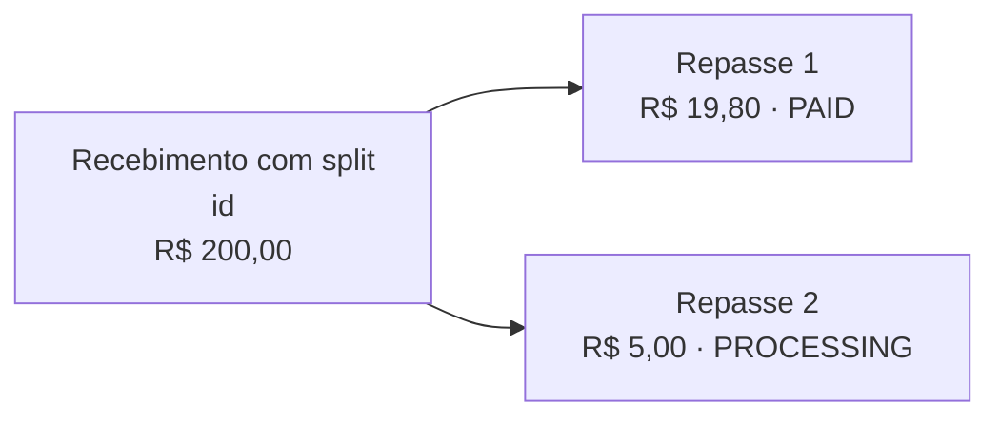
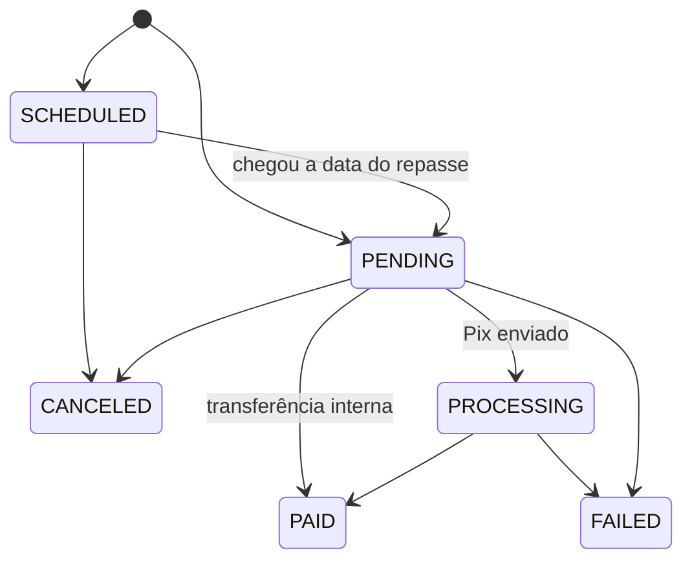

<Warning>
**Funcionalidade em beta.** As rotas, os campos e os status descritos aqui são uma proposta e podem mudar antes da versão final. Não use em produção sem alinhar com o time Delfinance.
</Warning>

Cada pagamento recebido com split gera um ou mais **repasses**, um para cada instrução. Com as APIs desta seção, você acompanha esses repasses depois que o pagamento entrou na conta de recebimento: quais foram pagos, quais estão em andamento, quais falharam e quanto cada beneficiário ainda tem a receber.

Isso vale para os dois tipos de split: o [split padrão da conta](/guias/split-pagamentos/configurar) e o [split por cobrança](/guias/split-pagamentos/split-por-cobranca). Os termos usados aqui seguem os [conceitos do Split de Pagamentos](/guias/split-pagamentos/visao-geral#conceitos).

<Tip>
Essas APIs são a base para montar um marketplace: a plataforma recebe o pagamento na conta de recebimento e consegue mostrar a cada vendedor (o beneficiário) o que já foi repassado e o que ainda vai receber. Veja a jornada completa no [guia para marketplaces](/guias/split-pagamentos/marketplace).
</Tip>

## Recebimento e repasses

Um **recebimento com split** é o pagamento original que chegou na conta de recebimento e gerou repasses. Ele é identificado pelo `id`, que é o id da transação de crédito no extrato e no webhook de recebimento.



Cada recebimento traz os valores usados no cálculo:

| Campo | Descrição |
|---|---|
| `grossAmount` | Valor integral do pagamento recebido |
| `tariffAmount` | Tarifa de split descontada antes do cálculo (`0` quando não há) |
| `splitBaseAmount` | Base de cálculo dos repasses: `grossAmount - tariffAmount` |
| `source` | Origem das instruções: `ACCOUNT_CONFIGURATION` (split padrão da conta) ou `QR_CODE` (split por cobrança) |

## Status do repasse



| Status | Significado | Final? |
|---|---|---|
| `SCHEDULED` | Repasse com data futura, ainda não executado. **Reservado para uma próxima fase**: hoje todo repasse é imediato | Não |
| `PENDING` | Pronto para ser executado | Não |
| `PROCESSING` | Pix enviado ao beneficiário, aguardando confirmação. Só acontece em repasses `PIX_MANUAL` | Não |
| `PAID` | Valor creditado na conta do beneficiário | Sim |
| `FAILED` | O repasse não pôde ser concluído. O motivo vem em `failureReason`, e o valor permanece na conta de recebimento | Sim |
| `CANCELED` | Repasse cancelado antes de ser executado. O valor permanece na conta de recebimento | Sim |

<Note>
Repasses `INTERNAL` passam direto de `PENDING` para `PAID`, porque a transferência entre contas Delfinance é instantânea. Repasses `PIX_MANUAL` passam por `PROCESSING` até a confirmação do Pix.
</Note>

<Info>
A falha de um repasse não afeta os outros repasses do mesmo recebimento. Cada repasse é executado e registrado de forma independente.
</Info>

## Passo a passo

<Steps>

<Step title="Liste os recebimentos com split">
Use `GET /baas/api/v1/split-payments/orders` para ver os pagamentos da conta de recebimento que geraram repasses, em um período. Cada item traz o valor recebido, a tarifa e a base de cálculo dos repasses.

```bash cURL
curl --location 'https://apisandbox.delbank.com.br/baas/api/v1/split-payments/orders?startDate=2026-10-01&endDate=2026-10-26&page=1&limit=20' \
--header 'x-delbank-api-key: {{apiKey}}' \
--header 'x-delfinance-account-id: {{accountId}}'
```

Para monitorar falhas, use [Listar repasses](/api-reference/split-pagamentos/listar-repasses) com `status=FAILED`.

Veja todos os filtros em [Listar recebimentos com split](/api-reference/split-pagamentos/listar-recebimentos).
</Step>

<Step title="Veja os repasses de um recebimento">
Use `GET /baas/api/v1/split-payments/orders/{id}` para ver o detalhe de um recebimento: os valores usados no cálculo e a lista completa de repasses, com o status de cada um.

```bash cURL
curl --location 'https://apisandbox.delbank.com.br/baas/api/v1/split-payments/orders/e7a0c1d2-5b3f-4a8e-9c61-2f4d8b7a1e90' \
--header 'x-delbank-api-key: {{apiKey}}' \
--header 'x-delfinance-account-id: {{accountId}}'
```

Veja a resposta completa em [Consultar recebimento com split](/api-reference/split-pagamentos/consultar-recebimento).
</Step>

<Step title="Acompanhe os repasses de um beneficiário">
Use `GET /baas/api/v1/split-payments/payouts` para listar repasses de todos os recebimentos, filtrando pelo documento do beneficiário, pelo status ou pela data do repasse. É a consulta indicada para mostrar a um vendedor o histórico de repasses dele.

```bash cURL
curl --location 'https://apisandbox.delbank.com.br/baas/api/v1/split-payments/payouts?beneficiaryDocument=12345678909&status=PAID&paymentDateFrom=2026-10-01&paymentDateTo=2026-10-26' \
--header 'x-delbank-api-key: {{apiKey}}' \
--header 'x-delfinance-account-id: {{accountId}}'
```

Veja todos os filtros em [Listar repasses](/api-reference/split-pagamentos/listar-repasses).
</Step>

<Step title="Consulte o valor a receber de um beneficiário">
Use `GET /baas/api/v1/split-payments/receivables` para saber quanto um beneficiário ainda vai receber: a soma dos repasses em `SCHEDULED`, `PENDING` e `PROCESSING`. Se você informar um período, a resposta também traz o total já pago nesse período.

```bash cURL
curl --location 'https://apisandbox.delbank.com.br/baas/api/v1/split-payments/receivables?beneficiaryDocument=12345678909&paidFrom=2026-10-01&paidTo=2026-10-26' \
--header 'x-delbank-api-key: {{apiKey}}' \
--header 'x-delfinance-account-id: {{accountId}}'
```

Veja a resposta completa em [Consultar valor a receber](/api-reference/split-pagamentos/consultar-valor-a-receber).
</Step>

<Step title="Cancele um repasse, se necessário">
Use `POST /baas/api/v1/split-payments/payouts/{payoutId}/cancel` para cancelar um repasse que ainda não foi executado. O valor permanece na conta de recebimento.

```bash cURL
curl --location 'https://apisandbox.delbank.com.br/baas/api/v1/split-payments/payouts/3f9b2c7e-8d14-4b6a-a0e5-71c2d9f4b8a3/cancel' \
--header 'Content-Type: application/json' \
--header 'x-delbank-api-key: {{apiKey}}' \
--header 'x-delfinance-account-id: {{accountId}}' \
--data '{
    "reason": "Pedido devolvido pelo comprador"
}'
```

Só é possível cancelar repasses em `SCHEDULED` ou `PENDING`. Nesses status, nenhum dinheiro saiu ainda da conta de recebimento.

Veja os detalhes em [Cancelar repasse](/api-reference/split-pagamentos/cancelar-repasse).
</Step>

</Steps>

## O que muda em cada fase

<Warning>
Nesta primeira fase, todo repasse é executado logo após o recebimento. Por isso, um repasse fica em `PENDING` por pouquíssimo tempo, e o cancelamento raramente é possível na prática. Pelo mesmo motivo, o valor a receber se resume aos repasses Pix ainda em `PROCESSING`.

O cancelamento e o valor a receber ganham uso real com os **repasses com data futura** (status `SCHEDULED`), previstos para uma próxima fase.
</Warning>

| Recurso | Agora (beta) | Próxima fase |
|---|---|---|
| Listar recebimentos e repasses | Disponível | Disponível |
| Status de cada repasse e motivo de falha | Disponível | Disponível |
| Valor a receber por beneficiário | Disponível, com repasses em andamento | Inclui repasses agendados |
| Cancelar repasse | Disponível para `PENDING` | Inclui repasses agendados (`SCHEDULED`) |
| Repasse com data futura | Não disponível | Previsto |
| Webhook de mudança de status do repasse | Em avaliação | Em avaliação |

## Referência da API

<CardGroup cols={2}>
  <Card title="Listar recebimentos com split" icon="list" href="/api-reference/split-pagamentos/listar-recebimentos">
    `GET /split-payments/orders`
  </Card>
  <Card title="Consultar recebimento com split" icon="magnifying-glass" href="/api-reference/split-pagamentos/consultar-recebimento">
    `GET /split-payments/orders/{id}`
  </Card>
  <Card title="Listar repasses" icon="arrow-right-arrow-left" href="/api-reference/split-pagamentos/listar-repasses">
    `GET /split-payments/payouts`
  </Card>
  <Card title="Consultar valor a receber" icon="wallet" href="/api-reference/split-pagamentos/consultar-valor-a-receber">
    `GET /split-payments/receivables`
  </Card>
  <Card title="Cancelar repasse" icon="ban" href="/api-reference/split-pagamentos/cancelar-repasse">
    `POST /split-payments/payouts/{payoutId}/cancel`
  </Card>
</CardGroup>
