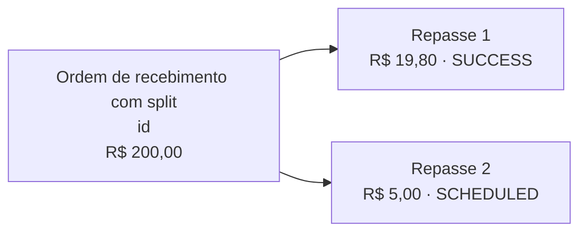
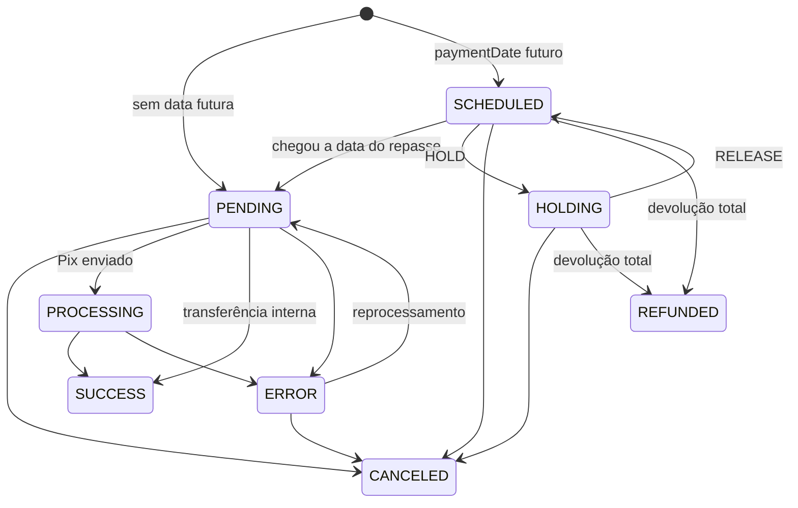

<Warning>
**Funcionalidade em beta.** As rotas, os campos e os status descritos aqui são uma proposta e podem mudar antes da versão final. Não use em produção sem alinhar com o time Delfinance.
</Warning>

Cada pagamento recebido com split gera uma **ordem de recebimento com split** e um **repasse** (*payout*) para cada instrução. Com as APIs desta seção, você acompanha esses repasses depois que o pagamento entrou na conta de recebimento: quais foram concluídos, quais estão agendados ou em andamento, quais falharam e quanto cada beneficiário ainda tem a receber.

Isso vale para os dois tipos de split: o [split padrão da conta](/guias/split-pagamentos/configurar) e o [split por cobrança](/guias/split-pagamentos/split-por-cobranca). Os termos usados aqui seguem os [conceitos do Split de Pagamentos](/guias/split-pagamentos/visao-geral#conceitos).

<Tip>
Essas APIs são a base para montar um marketplace: a plataforma recebe o pagamento na conta de recebimento e consegue mostrar a cada vendedor (o beneficiário) o que já foi repassado e o que ainda vai receber. Veja a jornada completa no [guia para marketplaces](/guias/split-pagamentos/marketplace).
</Tip>

## Ordem de recebimento com split e repasses

A **ordem de recebimento com split** é o registro criado quando um pagamento com instruções de split chega na conta de recebimento. Ela guarda os valores usados no cálculo e agrupa os repasses gerados. É identificada pelo `id`, que é o id da transação de crédito no extrato e no webhook de recebimento.



Cada ordem traz os valores usados no cálculo:

| Campo | Descrição |
|---|---|
| `grossAmount` | Valor integral do pagamento recebido |
| `tariffAmount` | Tarifa de split descontada antes do cálculo (`0` quando não há) |
| `splitBaseAmount` | Base de cálculo dos repasses: `grossAmount - tariffAmount` |
| `source` | Origem das instruções: `ACCOUNT_CONFIGURATION` (split padrão da conta) ou `QR_CODE` (split por cobrança) |
| `payer` | Conta de quem pagou o Pix: número, agência, tipo, titular (`holder`) e instituição (`participant`) |

## Formato dos enums

Os campos de enum das respostas (`status`, `transferType`, `instructionType` e `source`) são retornados como objeto:

```json
"status": {
    "name": "SUCCESS",
    "description": "Sucesso",
    "value": 1
}
```

| Campo | Descrição |
|---|---|
| `name` | Identificador do valor. **Use este campo na lógica da sua integração** |
| `description` | Texto descritivo, para exibição |
| `value` | Valor numérico interno. Não use na lógica da integração |

Nos filtros das consultas (query params), informe só o `name`, por exemplo `status=ERROR`.

## Status do repasse



| Status (`name`) | Significado | Final? |
|---|---|---|
| `SCHEDULED` | Repasse com data futura (`paymentDate`), ainda não executado. É executado automaticamente na data | Não |
| `PENDING` | Pronto para ser executado | Não |
| `HOLDING` | Repasse pausado pelo gestor do marketplace, por exemplo, por uma disputa da venda. Não é executado até ser liberado. Os dados da pausa vêm em `holdDetails` | Não |
| `PROCESSING` | Pix enviado ao beneficiário, aguardando confirmação. Só acontece em repasses `PIX_MANUAL` | Não |
| `SUCCESS` | Valor creditado na conta do beneficiário | Sim |
| `ERROR` | O repasse não pôde ser concluído. O motivo vem em `errorMessage`, e o valor permanece na conta de recebimento. Pode ser [reprocessado](/api-reference/split-pagamentos/reprocessar-repasses) | Não |
| `CANCELED` | Repasse cancelado antes de ser executado. O valor permanece na conta de recebimento. Os dados do cancelamento vêm em `cancellationDetails` | Sim |
| `REFUNDED` | Todo o valor do repasse foi devolvido ao cliente final antes da execução. Veja [Devoluções](#devoluções) | Sim |

<Note>
Repasses `INTERNAL` passam direto de `PENDING` para `SUCCESS`, porque a transferência entre contas Delfinance é instantânea. Repasses `PIX_MANUAL` passam por `PROCESSING` até a confirmação do Pix.
</Note>

<Info>
A falha de um repasse não afeta os outros repasses da mesma ordem. Cada repasse é executado e registrado de forma independente.
</Info>

## Repasses agendados

Na criação do QR Code, cada instrução de split pode ter um `paymentDate`, a data em que o repasse deve ser feito. Veja como em [Agendar um repasse](/guias/split-pagamentos/split-por-cobranca#agendar-um-repasse).

- **Sem `paymentDate`, ou com a data de hoje:** o repasse nasce em `PENDING` e é executado logo após o recebimento.
- **Com `paymentDate` futuro:** o repasse nasce em `SCHEDULED` e é executado automaticamente na data.

Enquanto o repasse está agendado, você pode [cancelá-lo, pausá-lo ou mudar a data](/api-reference/split-pagamentos/atualizar-repasse), [devolver parte do valor](/api-reference/split-pagamentos/devolver-repasse) ou [antecipá-lo com o reprocessamento](/api-reference/split-pagamentos/reprocessar-repasses).

<Warning>
Até a data do repasse, o valor fica na conta de recebimento. Mantenha saldo suficiente para os repasses agendados: se faltar saldo na data, o repasse termina em `ERROR` e precisa ser reprocessado.
</Warning>

## Devoluções

Quando parte de uma venda é desfeita antes do repasse, por exemplo, em uma disputa em que o cliente final devolve um item do pedido, você pode **devolver** essa parte ao cliente final e descontá-la do repasse do beneficiário:

1. [Pause o repasse](/api-reference/split-pagamentos/atualizar-repasse) com `HOLD`, para que ele não seja executado enquanto a disputa está aberta.
2. [Devolva o valor acordado](/api-reference/split-pagamentos/devolver-repasse). A Delfinance envia um Pix de devolução ao cliente final, vinculado ao Pix original, e desconta o valor do repasse: o `amount` diminui e o `refundedAmount` aumenta.
3. [Libere o repasse](/api-reference/split-pagamentos/atualizar-repasse) com `RELEASE`. O beneficiário recebe o valor restante na data do repasse.

Só é possível devolver enquanto o repasse está em `SCHEDULED` ou `HOLDING`. Você pode fazer várias devoluções no mesmo repasse. Quando a soma delas chega ao valor original do repasse, ele vai para `REFUNDED` e não é executado.

<Note>
Depois que o repasse é concluído (`SUCCESS`), o dinheiro já está na conta do beneficiário e não há devolução de repasse. A conta de recebimento ainda pode devolver o Pix original ao cliente final, mas o valor sai do caixa do marketplace.
</Note>

## Passo a passo

<Steps>

<Step title="Liste as ordens de recebimento com split">
Use `GET /baas/api/v1/split-payments/orders` para ver os pagamentos da conta de recebimento que geraram repasses, em um período. Cada item traz o valor recebido, a tarifa e a base de cálculo dos repasses.

```bash cURL
curl --location 'https://apisandbox.delbank.com.br/baas/api/v1/split-payments/orders?startDate=2026-10-01&endDate=2026-10-26&page=1&limit=20' \
--header 'x-delbank-api-key: {{apiKey}}' \
--header 'x-delfinance-account-id: {{accountId}}'
```

Para monitorar falhas, use [Listar repasses](/api-reference/split-pagamentos/listar-repasses) com `status=ERROR`.

Veja todos os filtros em [Listar ordens de recebimento com split](/api-reference/split-pagamentos/listar-recebimentos).
</Step>

<Step title="Veja os repasses de uma ordem">
Use `GET /baas/api/v1/split-payments/orders/{id}` para ver o detalhe de uma ordem de recebimento com split: os valores usados no cálculo e a lista completa de repasses, com o status de cada um.

```bash cURL
curl --location 'https://apisandbox.delbank.com.br/baas/api/v1/split-payments/orders/e7a0c1d2-5b3f-4a8e-9c61-2f4d8b7a1e90' \
--header 'x-delbank-api-key: {{apiKey}}' \
--header 'x-delfinance-account-id: {{accountId}}'
```

Veja a resposta completa em [Consultar ordem de recebimento com split](/api-reference/split-pagamentos/consultar-recebimento).
</Step>

<Step title="Acompanhe os repasses de um beneficiário">
Use `GET /baas/api/v1/split-payments/payouts` para listar repasses de todas as ordens, filtrando por beneficiário (documento ou nome), status, forma de repasse, data de criação ou data prevista do repasse. É a consulta indicada para mostrar a um vendedor o histórico de repasses dele.

```bash cURL
curl --location 'https://apisandbox.delbank.com.br/baas/api/v1/split-payments/payouts?beneficiaryDocument=12345678909&status=SUCCESS&paymentDateFrom=2026-10-01&paymentDateTo=2026-10-26' \
--header 'x-delbank-api-key: {{apiKey}}' \
--header 'x-delfinance-account-id: {{accountId}}'
```

Veja todos os filtros em [Listar repasses](/api-reference/split-pagamentos/listar-repasses).
</Step>

<Step title="Consulte o valor a receber de um beneficiário">
Use `GET /baas/api/v1/split-payments/receivables` para saber quanto um beneficiário ainda vai receber: a soma dos repasses em `SCHEDULED`, `PENDING` e `PROCESSING`. Se você informar um período, a resposta também traz o total já recebido nesse período.

```bash cURL
curl --location 'https://apisandbox.delbank.com.br/baas/api/v1/split-payments/receivables?beneficiaryDocument=12345678909&paidFrom=2026-10-01&paidTo=2026-10-26' \
--header 'x-delbank-api-key: {{apiKey}}' \
--header 'x-delfinance-account-id: {{accountId}}'
```

Veja a resposta completa em [Consultar valor a receber](/api-reference/split-pagamentos/consultar-valor-a-receber).
</Step>

<Step title="Reprocesse um repasse, se necessário">
Use `POST /baas/api/v1/split-payments/payouts/{payoutId}/process` para enviar um repasse para execução agora. Use para:

- tentar de novo um repasse em `ERROR`, depois de corrigir a causa (por exemplo, saldo insuficiente);
- destravar um repasse parado em `PENDING`;
- antecipar um repasse agendado (`SCHEDULED`).

```bash cURL
curl --location --request POST 'https://apisandbox.delbank.com.br/baas/api/v1/split-payments/payouts/5d2e8f1a-7c3b-4e9d-a6f0-1b2c3d4e5f60/process' \
--header 'x-delbank-api-key: {{apiKey}}' \
--header 'x-delfinance-account-id: {{accountId}}'
```

A resposta `200` confirma que o repasse foi enviado para execução, não que foi concluído. Acompanhe o resultado em [Listar repasses](/api-reference/split-pagamentos/listar-repasses).

Veja os detalhes em [Reprocessar repasse](/api-reference/split-pagamentos/reprocessar-repasses).
</Step>

<Step title="Pause, libere, cancele ou mude a data de um repasse, se necessário">
Use `PATCH /baas/api/v1/split-payments/payouts/{payoutId}` para atualizar um repasse que ainda não foi executado. No body, informe a ação (`action.type`), a nova data (`paymentDate`) ou os dois:

- `HOLD` pausa um repasse agendado, por exemplo, quando o comprador abre uma disputa. O repasse vai para `HOLDING` e não é executado nem na data prevista;
- `RELEASE` libera um repasse pausado, quando a disputa é resolvida. Ele volta para `SCHEDULED`. Junto com `paymentDate`, define a nova data do repasse;
- `CANCEL` cancela o repasse, por exemplo, quando o pedido é devolvido;
- só `paymentDate` muda a data de um repasse agendado.

```bash cURL
curl --location --request PATCH 'https://apisandbox.delbank.com.br/baas/api/v1/split-payments/payouts/3f9b2c7e-8d14-4b6a-a0e5-71c2d9f4b8a3' \
--header 'Content-Type: application/json' \
--header 'x-delbank-api-key: {{apiKey}}' \
--header 'x-delfinance-account-id: {{accountId}}' \
--data '{
    "action": {
        "type": "HOLD",
        "reason": "Disputa aberta pelo comprador",
        "requestedBy": "Equipe financeira"
    }
}'
```

Enquanto o repasse não é executado, nenhum dinheiro sai da conta de recebimento. Pausar ou cancelar só impede que o valor seja repassado.

Veja os status aceitos por cada ação em [Atualizar repasse](/api-reference/split-pagamentos/atualizar-repasse).
</Step>

<Step title="Devolva parte de um repasse, se necessário">
Use `POST /baas/api/v1/split-payments/payouts/{payoutId}/refunds` para devolver ao cliente final parte do valor da venda. O valor é descontado do repasse do beneficiário.

```bash cURL
curl --location 'https://apisandbox.delbank.com.br/baas/api/v1/split-payments/payouts/3f9b2c7e-8d14-4b6a-a0e5-71c2d9f4b8a3/refunds' \
--header 'Content-Type: application/json' \
--header 'x-delbank-api-key: {{apiKey}}' \
--header 'x-delfinance-account-id: {{accountId}}' \
--data '{
    "amount": 30.00,
    "reason": "Devolução de 1 item do pedido 4821",
    "requestedBy": "Equipe financeira"
}'
```

Acompanhe o Pix de devolução em [Listar devoluções de um repasse](/api-reference/split-pagamentos/listar-devolucoes-repasse). Veja as regras em [Devolver parte de um repasse](/api-reference/split-pagamentos/devolver-repasse).
</Step>

</Steps>

## O que ainda está em avaliação

| Recurso | Situação |
|---|---|
| Webhook de mudança de status do repasse | Em avaliação. Por enquanto, acompanhe pelas consultas |
| Agendamento no split padrão da conta | Não disponível. Só o split por cobrança aceita `paymentDate` |

## Referência da API

<CardGroup cols={2}>
  <Card title="Listar ordens de recebimento com split" icon="list" href="/api-reference/split-pagamentos/listar-recebimentos">
    `GET /split-payments/orders`
  </Card>
  <Card title="Consultar ordem de recebimento com split" icon="magnifying-glass" href="/api-reference/split-pagamentos/consultar-recebimento">
    `GET /split-payments/orders/{id}`
  </Card>
  <Card title="Listar repasses" icon="arrow-right-arrow-left" href="/api-reference/split-pagamentos/listar-repasses">
    `GET /split-payments/payouts`
  </Card>
  <Card title="Consultar valor a receber" icon="wallet" href="/api-reference/split-pagamentos/consultar-valor-a-receber">
    `GET /split-payments/receivables`
  </Card>
  <Card title="Reprocessar repasse" icon="rotate" href="/api-reference/split-pagamentos/reprocessar-repasses">
    `POST /split-payments/payouts/{payoutId}/process`
  </Card>
  <Card title="Atualizar repasse" icon="pen-to-square" href="/api-reference/split-pagamentos/atualizar-repasse">
    `PATCH /split-payments/payouts/{payoutId}`
  </Card>
  <Card title="Devolver parte de um repasse" icon="arrow-rotate-left" href="/api-reference/split-pagamentos/devolver-repasse">
    `POST /split-payments/payouts/{payoutId}/refunds`
  </Card>
  <Card title="Listar devoluções de um repasse" icon="receipt" href="/api-reference/split-pagamentos/listar-devolucoes-repasse">
    `GET /split-payments/payouts/{payoutId}/refunds`
  </Card>
</CardGroup>
