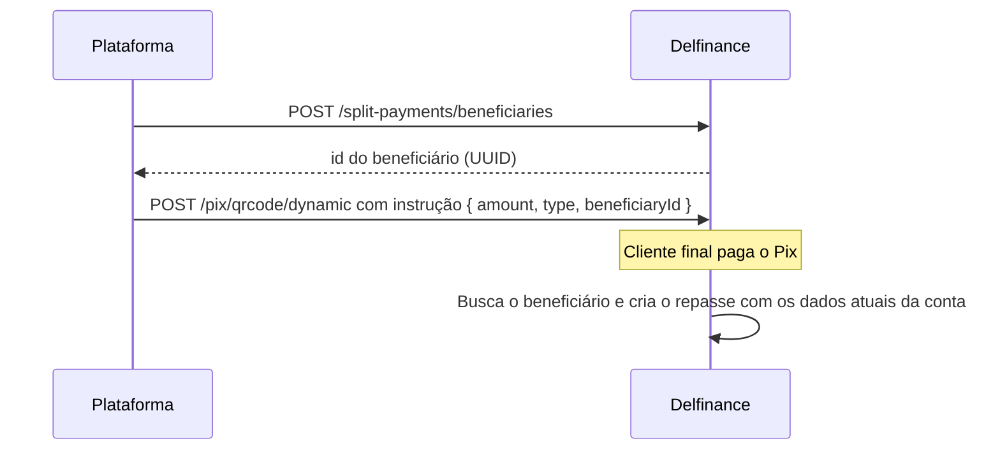

<Warning>
**Funcionalidade em beta.** As rotas e os campos descritos aqui são uma proposta e podem mudar antes da versão final. Não use em produção sem alinhar com o time Delfinance.
</Warning>

O cadastro de beneficiários guarda, na sua conta de recebimento, os dados de cada **beneficiário**: a forma de repasse e a conta para onde vai a parte dele. Com o beneficiário cadastrado, a instrução de split do QR Code leva só o valor, o tipo e o `beneficiaryId`.

Sem o cadastro, cada instrução precisa enviar o objeto `beneficiary` completo. Os dois formatos continuam aceitos. Veja [Usar um beneficiário cadastrado](/guias/split-pagamentos/split-por-cobranca#usar-um-beneficiário-cadastrado).

<Tip>
Em um marketplace, cadastre cada vendedor quando ele entra na plataforma e guarde o `id` retornado junto com o cadastro dele. Use o `externalId` para gravar o id do vendedor no seu sistema e encontrá-lo depois.
</Tip>

## Como funciona



1. Você cadastra o beneficiário, com a forma de repasse (`transferType`) e os dados da conta (`account`).
2. A Delfinance devolve o `id` do beneficiário, um UUID.
3. Nas instruções de split do QR Code, você informa o `beneficiaryId` no lugar do `transferType` e do objeto `beneficiary`.
4. Quando o Pix é pago, a Delfinance busca o beneficiário e cria o repasse com os dados da conta daquele momento.

Cada beneficiário pertence à conta de recebimento que o cadastrou. Uma conta não vê nem usa os beneficiários de outra.

## Cadastrar um beneficiário

O corpo tem a forma de repasse na raiz e os dados da conta em `account`, no mesmo formato do `beneficiary` da [instrução de split](/guias/split-pagamentos/split-por-cobranca#beneficiário-beneficiary).

<Tabs>
  <Tab title="INTERNAL">
    Para uma conta Delfinance, basta o número da conta.

    ```json
    {
        "externalId": "seller-4820",
        "transferType": "INTERNAL",
        "account": {
            "number": "10073"
        }
    }
    ```
  </Tab>
  <Tab title="PIX_MANUAL">
    Para uma conta em qualquer instituição, informe os dados bancários completos.

    ```json
    {
        "externalId": "seller-4821",
        "transferType": "PIX_MANUAL",
        "account": {
            "number": "123456",
            "branch": "0001",
            "type": "CURRENT",
            "participantIspb": "00000000",
            "holder": {
                "document": "12345678909",
                "name": "Maria Souza",
                "type": "NATURAL"
            }
        }
    }
    ```
  </Tab>
  <Tab title="PIX_KEY">
    Para uma conta em qualquer instituição, por chave Pix, informe a chave e o titular.

    ```json
    {
        "externalId": "seller-4822",
        "transferType": "PIX_KEY",
        "account": {
            "pixKey": "12345678909",
            "holder": {
                "document": "12345678909",
                "name": "Maria Souza",
                "type": "NATURAL"
            }
        }
    }
    ```
  </Tab>
</Tabs>

Veja todos os campos e as regras de validação em [Cadastrar beneficiário](/api-reference/split-pagamentos/beneficiarios/cadastrar).

## Usar o beneficiário numa cobrança

Na instrução de split do QR Code, troque o `transferType` e o `beneficiary` pelo `beneficiaryId`:

```json
{
    "amount": 10,
    "type": "PERCENTAGE",
    "beneficiaryId": "6f1c2a9e-3b7d-4e8a-9c21-5d4f0e7b8a13",
    "daysUntilPayment": 30
}
```

O `beneficiaryId` não é verificado na criação do QR Code, só no pagamento. Se o beneficiário não existir, for de outra conta ou estiver inativo, o repasse é criado em `ERROR`, nenhuma transferência é feita e o valor fica na conta de recebimento. Veja [Usar um beneficiário cadastrado](/guias/split-pagamentos/split-por-cobranca#usar-um-beneficiário-cadastrado).

## Atualizar e inativar

- **Atualizar:** use [Atualizar beneficiário](/api-reference/split-pagamentos/beneficiarios/atualizar) para mudar a forma de repasse, os dados da conta ou o `externalId`. A mudança vale para os repasses criados **depois** dela. Os repasses já criados guardam os dados da conta que tinham no momento da criação.
- **Inativar:** use [Inativar beneficiário](/api-reference/split-pagamentos/beneficiarios/inativar). O beneficiário não é apagado e continua aparecendo nas consultas, mas os novos pagamentos que o referenciarem geram repasses em `ERROR`.

## Acompanhar os repasses de um beneficiário

Cada repasse criado a partir de um beneficiário cadastrado traz o `beneficiaryId`. Para ver todos os repasses de um beneficiário, inclusive os criados antes de uma mudança na conta dele, filtre [Listar repasses](/api-reference/split-pagamentos/listar-repasses) por `beneficiaryId`.

<Note>
Nas rotas do [split padrão da conta](/guias/split-pagamentos/configurar), o caminho `/configurations/{splitPaymentId}/beneficiaries` se refere às **instruções** do split padrão, e não a este cadastro. O split padrão ainda não aceita `beneficiaryId`.
</Note>

## Referência da API

<CardGroup cols={2}>
  <Card title="Cadastrar beneficiário" icon="user-plus" href="/api-reference/split-pagamentos/beneficiarios/cadastrar">
    `POST /split-payments/beneficiaries`
  </Card>
  <Card title="Listar beneficiários" icon="list" href="/api-reference/split-pagamentos/beneficiarios/listar">
    `GET /split-payments/beneficiaries`
  </Card>
  <Card title="Consultar beneficiário" icon="magnifying-glass" href="/api-reference/split-pagamentos/beneficiarios/consultar">
    `GET /split-payments/beneficiaries/{id}`
  </Card>
  <Card title="Atualizar beneficiário" icon="pen-to-square" href="/api-reference/split-pagamentos/beneficiarios/atualizar">
    `PATCH /split-payments/beneficiaries/{id}`
  </Card>
  <Card title="Inativar beneficiário" icon="user-slash" href="/api-reference/split-pagamentos/beneficiarios/inativar">
    `DELETE /split-payments/beneficiaries/{id}`
  </Card>
</CardGroup>
