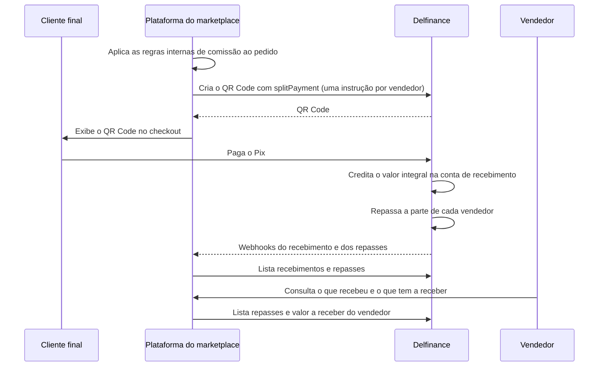

<Warning>
**Parte deste guia usa funcionalidades em beta.** As consultas de recebimentos, repasses e valor a receber estão em beta, e o contrato pode mudar antes da versão final. Veja [Acompanhar repasses](/guias/split-pagamentos/acompanhar-repasses).
</Warning>

Este guia mostra, de ponta a ponta, como um marketplace usa o Split de Pagamentos da Delfinance: o comprador paga o pedido inteiro, a Delfinance repassa automaticamente a parte de cada vendedor e a parte do marketplace fica na conta dele. Depois, a plataforma consulta os recebimentos e oferece a cada vendedor uma visão do que ele já recebeu e do que tem a receber.

## Quem participa

| Papel | Quem é | No Split de Pagamentos |
|---|---|---|
| **Gestor do marketplace** | A empresa dona do marketplace, titular de uma conta Delfinance | Titular da **conta de recebimento** |
| **Plataforma** | O sistema do marketplace, integrado à API da Delfinance | Cria as cobranças e consulta os repasses |
| **Cliente final** | Quem compra no marketplace | O pagador do Pix |
| **Vendedor** | Quem vende o produto pelo marketplace | O **beneficiário** |
| **Conta do vendedor** | A conta bancária onde o vendedor recebe | A **conta do beneficiário**, na Delfinance ou em outro banco |

Os termos em negrito seguem os [conceitos do Split de Pagamentos](/guias/split-pagamentos/visao-geral#conceitos).

## Visão geral da jornada



## Passo a passo

<Steps>

<Step title="Abra a conta de recebimento">
O gestor do marketplace abre uma conta Delfinance. Essa é a **conta de recebimento**: todo pagamento dos pedidos entra nela com o valor integral, e é dela que saem os repasses para os vendedores.

A plataforma usa a API key dessa conta e envia o número dela no header `x-delfinance-account-id` em todas as chamadas.
</Step>

<Step title="Defina as regras de comissão na plataforma">
As regras de negócio do marketplace ficam **na sua plataforma**, não na Delfinance. Por exemplo: comissão de 10% por venda, comissão diferente por categoria, valor fixo por pedido, frete repassado integralmente ao vendedor.

A cada venda, a plataforma aplica essas regras e transforma o resultado em **instruções de split**, uma por vendedor do pedido. A Delfinance só executa as instruções recebidas em cada cobrança.

<Tip>
A parte do marketplace não precisa de instrução: ela é o que sobra na conta de recebimento depois dos repasses.
</Tip>

<Note>
Você não precisa configurar o [split padrão da conta](/guias/split-pagamentos/configurar). Quando a cobrança traz instruções próprias, elas substituem o split padrão para aquele pagamento.
</Note>
</Step>

<Step title="Gere o QR Code do pedido com as instruções de split">
No checkout, a plataforma cria um [QR Code dinâmico](/guias/pix/receber-pix/cobranca-imediata) com o valor do pedido e o objeto `splitPayment`.

No exemplo abaixo, um carrinho de R\$ 100,00 tem dois produtos de vendedores diferentes, com comissão de 10% para o marketplace:

- Produto do vendedor A, de R\$ 60,00: o vendedor recebe R\$ 54,00 em uma conta Delfinance.
- Produto da vendedora B, de R\$ 40,00: a vendedora recebe R\$ 36,00 em uma conta de outro banco.
- O marketplace fica com R\$ 10,00 na conta de recebimento.

```bash cURL
curl --location 'https://apisandbox.delbank.com.br/baas/api/v2/pix/qrcode/dynamic' \
--header 'Content-Type: application/json' \
--header 'x-delbank-api-key: {{apiKey}}' \
--header 'x-delfinance-account-id: {{contaDeRecebimento}}' \
--data '{
    "correlationId": "{{idDoPedido}}",
    "amount": 100.00,
    "expiresIn": 1800,
    "formatResponse": "PAYLOAD_AND_QRCODE",
    "splitPayment": {
        "canChargeTariffBeforeSplit": true,
        "instructions": [
            {
                "amount": 54.00,
                "type": "FIXED",
                "transferType": "INTERNAL",
                "beneficiary": {
                    "bankAccountNumber": "10073"
                }
            },
            {
                "amount": 36.00,
                "type": "FIXED",
                "transferType": "PIX_MANUAL",
                "beneficiary": {
                    "bankAccountNumber": "123456",
                    "bankAccountBranch": "0001",
                    "participantIspb": "00000000",
                    "bankAccountType": "CURRENT",
                    "holderName": "Maria Souza",
                    "holderDocument": "12345678909"
                }
            }
        ]
    }
}'
```

Use o id do pedido como `correlationId`. Ele volta no webhook de recebimento e liga o pagamento ao pedido na sua plataforma.

Veja todos os campos e regras de validação em [Split por cobrança (QR Code)](/guias/split-pagamentos/split-por-cobranca).
</Step>

<Step title="O cliente paga e os repasses acontecem automaticamente">
Quando o cliente final paga o Pix, a Delfinance credita o valor integral na conta de recebimento e, em seguida, faz um repasse para a conta de cada vendedor. A plataforma não precisa fazer nenhuma transferência.

A plataforma recebe os webhooks:

- `PIX_RECEIVED`, com o pagamento do pedido;
- `TRANSFER_INTERNAL_DEBITED`, para cada repasse a uma conta Delfinance;
- `PIX_PAYMENT_UPDATED`, para cada repasse via Pix a uma conta de outro banco.
</Step>

<Step title="Acompanhe os recebimentos do marketplace">
Para a gestão do marketplace (conciliação, relatórios, painel financeiro), use [Listar recebimentos com split](/api-reference/split-pagamentos/listar-recebimentos). Cada item mostra o valor integral do pagamento, a tarifa e a base de cálculo dos repasses.

Para ver os repasses de um pedido específico, use [Consultar recebimento com split](/api-reference/split-pagamentos/consultar-recebimento) com o `id` da transação de recebimento.

Para monitorar problemas, use [Listar repasses](/api-reference/split-pagamentos/listar-repasses) com `status=FAILED` e trate os repasses que falharam.
</Step>

<Step title="Mostre a cada vendedor o que ele recebeu e o que tem a receber">
Para montar a área do vendedor na sua plataforma, filtre as consultas pelo documento do vendedor (`beneficiaryDocument`):

- [Listar repasses](/api-reference/split-pagamentos/listar-repasses): o extrato de repasses do vendedor, com o status de cada um. Cada repasse traz o objeto `splitPayment`, com o valor integral da venda, a data e a base de cálculo, para o vendedor ver quanto vendeu e quanto recebeu.
- [Consultar valor a receber](/api-reference/split-pagamentos/consultar-valor-a-receber): quanto o vendedor ainda tem a receber e, informando um período, quanto já recebeu.

```bash cURL
curl --location 'https://apisandbox.delbank.com.br/baas/api/v1/split-payments/payouts?beneficiaryDocument=12345678909&paymentDateFrom=2026-10-01&paymentDateTo=2026-10-31' \
--header 'x-delbank-api-key: {{apiKey}}' \
--header 'x-delfinance-account-id: {{contaDeRecebimento}}'
```

<Note>
Nesta fase, todo repasse é executado logo após o pagamento. Por isso, o valor a receber se resume aos repasses Pix ainda em processamento. Com os repasses com data futura, previstos para uma próxima fase, o vendedor também vai ver os valores agendados.
</Note>
</Step>

</Steps>

## Tarifa e comissão

Com `canChargeTariffBeforeSplit` igual a `true` (padrão), a tarifa de split é descontada do valor recebido antes do cálculo dos repasses. O efeito depende do `type` das instruções:

| `type` das instruções | Quem absorve a tarifa |
|---|---|
| `PERCENTAGE` | Marketplace e vendedores, proporcionalmente, porque os percentuais incidem sobre o valor líquido |
| `FIXED` | Só o marketplace, porque os vendedores recebem exatamente o valor informado |

<Warning>
Com valores fixos, deixe margem para a tarifa. Se a soma dos repasses ultrapassar o valor líquido do pagamento, **nenhum** repasse daquele pedido é executado, e o valor integral fica na conta de recebimento.
</Warning>

## Boas práticas

<AccordionGroup>
  <Accordion title="Guarde o documento de cada vendedor do jeito que a API usa">
    As consultas da área do vendedor filtram pelo CPF ou CNPJ do beneficiário (`beneficiaryDocument`), somente números. Use sempre o mesmo documento do vendedor nas instruções de split e nas consultas.
  </Accordion>
  <Accordion title="Valide os dados bancários dos vendedores no cadastro">
    A Delfinance não valida os dados da conta do beneficiário na criação do QR Code. Um dado incorreto só aparece como falha no momento do repasse. Valide agência, conta, ISPB e documento quando o vendedor se cadastrar na sua plataforma.
  </Accordion>
  <Accordion title="Prefira contas Delfinance para os vendedores">
    Repasses `INTERNAL` são instantâneos e vão direto para `PAID`. Repasses `PIX_MANUAL` dependem da confirmação do Pix pela instituição do vendedor.
  </Accordion>
  <Accordion title="Calcule os valores na plataforma">
    Quando o pedido tem frete, desconto ou comissões diferentes por produto, calcule o valor de cada vendedor na plataforma e envie como `FIXED`. Assim o repasse corresponde exatamente ao que o seu sistema registrou.
  </Accordion>
  <Accordion title="Trate devoluções e cancelamentos de pedido">
    Um repasse só pode ser cancelado antes de ser executado. Nesta fase, os repasses são imediatos, então, se o pedido for devolvido depois do pagamento, o acerto com o vendedor precisa ser feito pela plataforma.
  </Accordion>
</AccordionGroup>

## Próximos passos

<CardGroup cols={3}>
  <Card title="Split por cobrança" icon="qrcode" href="/guias/split-pagamentos/split-por-cobranca">
    Campos, validações e cálculo das instruções de split no QR Code.
  </Card>
  <Card title="Acompanhar repasses" icon="list-check" href="/guias/split-pagamentos/acompanhar-repasses">
    Status dos repasses, consultas e cancelamento.
  </Card>
  <Card title="Webhooks de Pix" icon="webhook" href="/guias/webhooks/pix">
    Trate o recebimento do pedido e os repasses via Pix.
  </Card>
</CardGroup>
