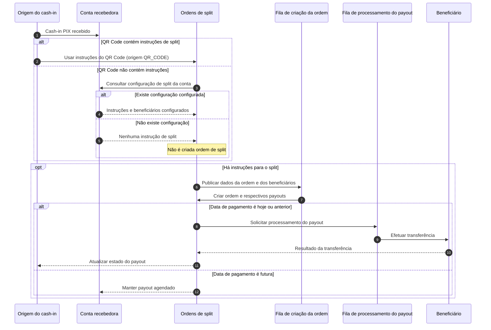

Este guia descreve como consultar ordens e payouts de Split de Pagamentos e como solicitar o processamento forçado ou o cancelamento de um payout. As rotas desta API operam sobre a conta autenticada, podendo consultar insformações somente da mesma.

## Conceitos

- **Ordem de split**: registra a divisão associada a um cash-in recebido. Uma ordem pode conter um ou mais payouts.
- **Payout**: valor destinado a um beneficiário, com uma instrução de transferência e um estado próprio.
- **Origem das instruções**: em cash-ins PIX, as instruções do QR Code são usadas quando presentes. Se não houver instruções no QR Code, o sistema consulta a configuração de split da conta recebedora. Sem instrução e sem configuração, não é gerada uma ordem de split para aquele fluxo.
- **Base do split**: valor bruto do cash-in menos a tarifa, quando a cobrança da tarifa antes do split estiver habilitada.

Payouts com data de pagamento futura ficam agendados. Payouts elegíveis para a data corrente podem seguir para processamento sem uma chamada manual. A API permite consultar o andamento e, quando aplicável, solicitar novamente o processamento ou cancelar a operação.

<Warning>
    O processamento automático de payouts agendados está em desenvolvimento, assim, por enquanto será necessário processa-los manualmente pelo endpoint de processamento.
</Warning>

<Note>
    Payouts só podem ser agendados através das instruções de split na criação do qr code.
</Note>

## Endpoints

Prefixo comum: `/api/v1/external/split-payments`

### Consultar ordens

Use `GET /orders` para buscar uma ordem específica ou listar as ordens da conta.

| Parâmetro | Obrigatório | Descrição |
|---|---:|---|
| `id` | Não | Identificador da ordem. |
| `transactionId` | Não | Identificador da transação original de cash-in associada à ordem. |
| `page` | Não | Página da listagem. Padrão: `1`. |
| `limit` | Não | Itens por página. Padrão: `10`; valores acima de `100` são limitados a `100`. |

`id` e `transactionId` são mutuamente exclusivos. Quando nenhum dos dois é informado, a resposta será uma listagem paginada.

<CodeGroup>
```bash cURL
curl --location 'https://api.delbank.com.br/api/v1/external/split-payments/orders?id=12345' \
--header 'x-delbank-api-key: {{apiKey}}'

curl --location 'https://api.delbank.com.br/api/v1/external/split-payments/orders?transactionId=ID-DO-CASHIN' \
--header 'x-delbank-api-key: {{apiKey}}'

curl --location 'https://api.delbank.com.br/api/v1/external/split-payments/orders?page=1&limit=20' \
--header 'x-delbank-api-key: {{apiKey}}'
```
```json Response (curl 1, 2)
{
    "id": 12345,
    "transactionOriginalId": "ID-DO-CASHIN",
    "grossAmount": 10.00,
    "tariffAmount": 0.25,
    "splitBaseAmount": 9.75,
    "source": {
        "name": "QR_CODE",
        "description": "QrCode",
        "value": 0
    },
    "createdAt": "2025-09-22T12:00:00.000Z",
    "payouts": [
        {
            "id": 12545,
            "splitOrderId": 12345,
            "beneficiary": {
                "bankIspb": "ISPBCODE",
                "bankAccountNumber": "12345",
                "bankAccountBranch": "0001",
                "holderDocument": "01234567890",
                "holderName": "Nome do beneficiário",
                "bankAccountType": "Tipo da conta bancária do beneficiário"
            },
            "transferType": {
                "name": "PIX_MANUAL",
                "description": "Pix Manual",
                "value": 2
            },
            "instructionType": {
                "name": "PERCENTAGE",
                "description": "Porcentagem",
                "value": 0
            },
            "instructionAmount": 85.00,
            "amount": 8.29,
            "paymentDate": "2025-09-22T12:00:00.000Z",
            "status": {
                "name": "SUCCESS",
                "description": "Sucesso",
                "value": 1
            },
            "transactionId": "ID-DO-SPLIT-CASHOUT",
            "endToEndId": "E2E-DO-SPLIT-CASHOUT",
            "paidAt": "2025-09-22T12:00:00.000Z",
            "createdAt": "2025-09-22T12:00:00.000Z",
            "updatedAt": "2025-09-22T12:00:00.000Z"
        }
    ]
}
```
```json Response (curl 3)
[
    {
        "id": 12345,
        "transactionOriginalId": "ID-DO-CASHIN",
        "grossAmount": 10.00,
        "tariffAmount": 0.25,
        "splitBaseAmount": 9.75,
        "source": {
            "name": "QR_CODE",
            "description": "QrCode",
            "value": 0
        },
        "createdAt": "2025-09-22T12:00:00.000Z"
    },
    {
        "id": 12346,
        "transactionOriginalId": "ID-DO-CASHIN",
        "grossAmount": 100.00,
        "tariffAmount": 0.00,
        "splitBaseAmount": 100.00,
        "source": {
            "name": "QR_CODE",
            "description": "QrCode",
            "value": 0
        },
        "createdAt": "2025-09-26T12:00:00.000Z"
    }
]
```
```json Response Pagination Header (curl 3)
{
    "currentPage": 1,
    "pageSize": 20,
    "pageCount": 1,
    "rowCount": 2
}
```
</CodeGroup>

A consulta individual retorna HTTP `200` e uma ordem com seus payouts. Se a ordem não existir ou não pertencer à conta da credencial, a API retorna `404`. Informar `id` e `transactionId` juntos retorna `400`.

A listagem também retorna HTTP `200`; por padrão, o corpo é um array. Para receber metadados de paginação no corpo, use `include=metadata`. Nesse formato, os itens ficam em `data` e os metadados em `metadata`.

### Consultar payouts

Use `GET /payouts` para consultar payouts da conta vinculada à credencial, com filtros opcionais.

| Parâmetro | Obrigatório | Descrição |
|---|---:|---|
| `beneficiaryDocument` | Não | CPF ou CNPJ do beneficiário. |
| `beneficiaryName` | Não | Nome do beneficiário; a busca aceita correspondência parcial. |
| `startDate` | Não | Data inicial para filtrar pela criação do payout. |
| `endDate` | Não | Data final para filtrar pela criação do payout. |
| `status` | Não | Estado do payout. Valores: `PENDING`, `PROCESSING`, `SUCCESS`, `ERROR`, `SCHEDULED` ou `CANCELED`. |
| `page` | Não | Página da listagem. Padrão: `1`. |
| `limit` | Não | Itens por página. Padrão: `10`. |

<CodeGroup>
```bash cURL
curl --location 'https://api.delbank.com.br/api/v1/external/split-payments/payouts?beneficiaryDocument=12345678901&status=ERROR&page=1&limit=10' \
--header 'x-delbank-api-key: {{apiKey}}'
```
```json Response
[
    {
        "id": 98765,
        "splitOrderId": 12345,
        "beneficiary": {
            "bankIspb": "ISPBCODE",
            "bankAccountNumber": "12345",
            "bankAccountBranch": "0001",
            "holderDocument": "12345678901",
            "holderName": "Nome do beneficiário",
            "bankAccountType": "Tipo da conta bancária do beneficiário"
        },
        "transferType": {
            "name": "PIX_MANUAL",
            "description": "Pix Manual",
            "value": 2
        },
        "instructionType": {
            "name": "PERCENTAGE",
            "description": "Porcentagem",
            "value": 0
        },
        "instructionAmount": 85.00,
        "amount": 8.29,
        "paymentDate": "2025-09-22T12:00:00.000Z",
        "status": {
            "name": "ERROR",
            "description": "Error",
            "value": 2
        },
        "transactionId": "ID-DO-SPLIT-CASHOUT",
        "endToEndId": "E2E-DO-SPLIT-CASHOUT",
        "errorMessage": "Banco rejeitou a transferência",
        "paidAt": "2025-09-22T12:00:00.000Z",
        "createdAt": "2025-09-22T12:00:00.000Z",
        "updatedAt": "2025-09-22T12:00:00.000Z",
        "splitOrder": {
            "id": 12345,
            "transactionOriginalId": "ID-DO-CASHIN",
            "grossAmount": 10.00,
            "tariffAmount": 0.25,
            "splitBaseAmount": 9.75,
            "source": {
                "name": "QR_CODE",
                "description": "QrCode",
                "value": 0
            },
            "createdAt": "2025-09-22T12:00:00.000Z",
        }
    }
]
```
```json Response Pagination Header
{
    "currentPage": 1,
    "pageSize": 10,
    "pageCount": 1,
    "rowCount": 1
}
```
</CodeGroup>

Cada payout pode incluir campos como `id`, `splitOrderId`, `beneficiary`, `transferType`, `instructionType`, `instructionAmount`, `amount`, `paymentDate`, `status`, `transactionId`, `endToEndId`, `errorMessage`, `cancellationDetails`, `paidAt`, `createdAt` e `updatedAt`. A resposta também pode incluir um resumo da ordem em `splitOrder`.

Os estados representam:

- `PENDING`: aguardando processamento;
- `PROCESSING`: em processamento;
- `SUCCESS`: concluído;
- `ERROR`: falha;
- `SCHEDULED`: agendado;
- `CANCELED`: cancelado.

<Tip>
Use o campo `status.name` ou `status.description` quando precisar identificar o estado da operação. O valor numérico do enum não é o identificador mais legível para a lógica de integração.
</Tip>

### Solicitar processamento

Use `POST /payouts/process` para reenviar um ou mais payouts para processamento quando eles estiverem elegíveis.

```http
POST /api/v1/external/split-payments/payouts/process
Content-Type: application/json
```

```json
{
  "splitPayoutIds": [98765, 98766]
}
```

Payouts elegíveis para solicitação de processamento podem estar nos estados `PENDING`, `SCHEDULED` e `ERROR`. A resposta `202 Accepted` confirma que a solicitação foi recebida, mas não que a transferência foi concluída. Consulte `GET /payouts` para acompanhar a evolução do estado.

<Warning>
Envie apenas IDs pertencentes à conta autenticada. IDs inexistentes, de outra conta ou em estados não elegíveis podem ser ignorados sem rejeição individual na resposta.
</Warning>

### Cancelar payout

Use `PATCH /payouts/cancel` para solicitar o cancelamento de um payout em `SCHEDULED` ou `ERROR`.

```http
PATCH /api/v1/external/split-payments/payouts/cancel
Content-Type: application/json
```

```json
{
  "splitPayoutId": 98765,
  "reason": "Solicitação do cliente",
  "canceledBy": "Nome ou identificação do solicitante"
}
```

`splitPayoutId` identifica o payout; `reason` registra o motivo e `canceledBy` identifica quem solicitou o cancelamento. Se `canceledBy` não for informado, a API registra `Não informado.`

Em caso de sucesso, a resposta é `202 Accepted`; o estado passa para `CANCELED` e os dados ficam disponíveis em `cancellationDetails` na consulta de payouts.

## Fluxo de alto nível



## Boas práticas de integração

1. Guarde `transactionOriginalId` e `id` da ordem para conciliar os payouts com o cash-in.
2. Use `GET /orders?transactionId=...` para localizar a ordem pela transação original e `GET /payouts` para acompanhar cada beneficiário.
3. Trate o processamento como assíncrono: após uma resposta `202`, consulte novamente o payout até obter o estado final.
4. Solicite cancelamento apenas para payouts em `SCHEDULED` ou `ERROR`; pagamentos já em processamento ou concluídos não são cancelados por esta rota.
5. Solicite o processamento forçado apenas quando o payout ficou travado em `PENDING`, quando houver erro elegível para reprocessamento ou quando for necessário antecipar um payout agendado.

## Referência da API

<CardGroup cols={2}>
  <Card title="Consultar Ordens de Split" icon="trash" href="/api-reference/split-pagamentos/consultar-ordens">
    `GET /baas/api/v1/split-payments/orders`
  </Card>
  <Card title="Consultar Split Payouts" icon="user-xmark" href="/api-reference/split-pagamentos/consultar-payouts">
    `GET /baas/api/v1/split-payments/payouts`
  </Card>
  <Card title="Cancelar Split Payout" icon="user-xmark" href="/api-reference/split-pagamentos/cancelar-payout">
    `PATCH /baas/api/v1/split-payments/payouts/cancel`
  </Card>
</CardGroup>