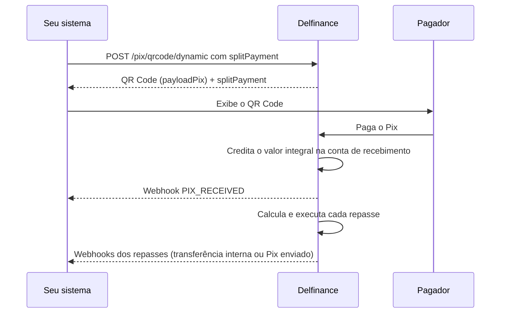
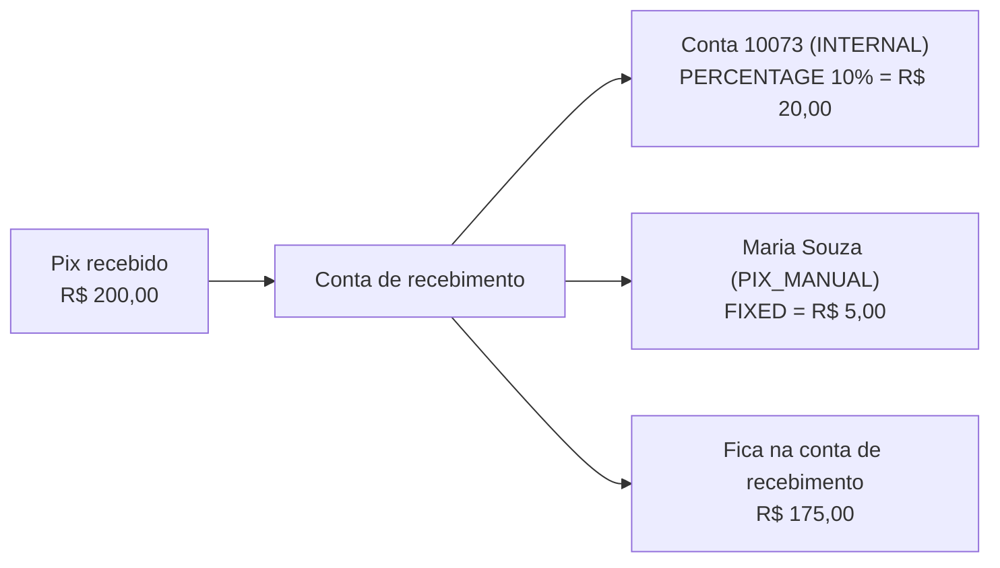

O split por cobrança permite definir **para quem e quanto repassar em cada QR Code**, no momento em que você cria a cobrança. Quando o pagador paga, a Delfinance credita o valor integral na conta de recebimento e, em seguida, repassa automaticamente as partes definidas para cada beneficiário, seja uma conta Delfinance ou uma conta em outro banco.

Os termos **conta de recebimento**, **beneficiário**, **conta do beneficiário** e **repasse** seguem os [conceitos do Split de Pagamentos](/guias/split-pagamentos/visao-geral#conceitos).

A diferença para o [split padrão da conta](/guias/split-pagamentos/configurar) é o escopo:

| | Split padrão da conta | Split por cobrança |
|---|---|---|
| Onde a regra é definida | Configuração da conta (`/split-payments/configurations`) | Campo `splitPayment` na criação do QR Code |
| A quem se aplica | Todo Pix recebido na conta | Apenas os pagamentos daquele QR Code |
| Beneficiários diferentes por venda | Não | Sim |
| Formas de repasse | `INTERNAL` e `PIX_MANUAL` | `INTERNAL` e `PIX_MANUAL` |

<Tip>
Use o split por cobrança quando cada venda tem um destinatário diferente. Por exemplo: em um marketplace, cada pedido é de um vendedor, e a parte de cada vendedor é repassada no próprio QR Code do pedido.
</Tip>

## Como funciona



1. Você cria o QR Code dinâmico com as instruções de repasse em `splitPayment.instructions`.
2. A Delfinance valida as instruções e as guarda junto com a cobrança.
3. Quando o Pix é pago, o valor **integral** entra na conta que criou o QR Code.
4. Logo depois, a Delfinance calcula o valor de cada instrução e transfere da conta de recebimento para cada beneficiário: por transferência interna (`INTERNAL`) ou por Pix (`PIX_MANUAL`).
5. O que não foi destinado a nenhuma instrução permanece na conta de recebimento.

<Note>
O split por cobrança está disponível apenas na [Cobrança Imediata (QR Code Dinâmico)](/guias/pix/receber-pix/cobranca-imediata). A cobrança com vencimento e o QR Code estático não aceitam `splitPayment`.
</Note>

## Passo a passo

<Steps>

<Step title="Crie o QR Code com as instruções de split">
Envie o objeto `splitPayment` junto com os demais dados da cobrança. Cada item de `instructions` é um repasse.

No exemplo abaixo, um pedido de R\$ 200,00 repassa 10% para a conta Delfinance do vendedor e R\$ 5,00 fixos, via Pix, para a conta de um afiliado em outro banco.

```bash cURL
curl --location 'https://apisandbox.delbank.com.br/baas/api/v2/pix/qrcode/dynamic' \
--header 'Content-Type: application/json' \
--header 'x-delbank-api-key: {{apiKey}}' \
--header 'x-delfinance-account-id: {{accountId}}' \
--data '{
    "correlationId": "{{$guid}}",
    "amount": 200.00,
    "expiresIn": 1800,
    "formatResponse": "PAYLOAD_AND_QRCODE",
    "splitPayment": {
        "instructions": [
            {
                "amount": 10,
                "type": "PERCENTAGE",
                "transferType": "INTERNAL",
                "beneficiary": {
                    "bankAccountNumber": "10073"
                }
            },
            {
                "amount": 5.00,
                "type": "FIXED",
                "transferType": "PIX_MANUAL",
                "beneficiary": {
                    "bankAccountNumber": "123456",
                    "bankAccountBranch": "0001",
                    "participantIspb": "00000000",
                    "bankAccountType": "CURRENT",
                    "holderName": "Maria Souza",
                    "holderDocument": "12345678909"
                }
            }
        ]
    }
}'
```

O header `x-delfinance-account-id` define a **conta de recebimento**: a conta que recebe o pagamento e de onde saem os repasses.
</Step>

<Step title="Confira a resposta">
A resposta é a mesma da criação de um QR Code dinâmico comum. O objeto `splitPayment` volta com as instruções registradas, para você confirmar o que foi gravado.

```json
{
    "correlationId": "40ede975-031d-4517-bdd4-31472d3f00a4",
    "transactionId": "vchargeffab8b4c963344c283e491f5e",
    "amount": 200.00,
    "expiresIn": 1800,
    "status": "ACTIVE",
    "payloadPix": "00020101021226820014br.gov.bcb.pix2560pix-h.delbank.com.br/v2/cob/...",
    "qrCodeImageBase64": "data:image/png;base64,iVBORw0KGgoAAAANSUhEUgAAAPoA...",
    "splitPayment": {
        "canChargeTariffBeforeSplit": true,
        "instructions": [
            {
                "amount": 10,
                "type": "PERCENTAGE",
                "transferType": "INTERNAL",
                "beneficiary": { "bankAccountNumber": "10073" }
            },
            {
                "amount": 5.00,
                "type": "FIXED",
                "transferType": "PIX_MANUAL",
                "beneficiary": {
                    "bankAccountNumber": "123456",
                    "bankAccountBranch": "0001",
                    "participantIspb": "00000000",
                    "bankAccountType": "CURRENT",
                    "holderName": "Maria Souza",
                    "holderDocument": "12345678909"
                }
            }
        ]
    }
}
```

Se alguma instrução não respeitar as [regras de validação](#regras-de-validação), o QR Code não é criado e a API retorna o erro `INVALID_SPLIT` com a lista de problemas encontrados.
</Step>

<Step title="Exiba o QR Code para o pagador">
Use o `payloadPix` (copia e cola) ou o `qrCodeImageBase64` normalmente. Para o pagador, nada muda: ele vê e paga o valor total da cobrança.
</Step>

<Step title="Acompanhe o recebimento e os repasses pelos webhooks">
Quando o Pix é pago, você recebe um evento [`PIX_RECEIVED`](/guias/webhooks/pix) com o valor integral. Em seguida, cada repasse gera os eventos da forma de transferência usada:

- **`INTERNAL`**: um [`TRANSFER_INTERNAL_DEBITED`](/guias/webhooks/transferencias) na conta de recebimento. Se a conta do beneficiário tiver webhook configurado, ela recebe um `TRANSFER_INTERNAL_CREDITED`.
- **`PIX_MANUAL`**: um [`PIX_PAYMENT_UPDATED`](/guias/webhooks/pix) com o status do Pix enviado ao beneficiário.
</Step>

</Steps>

## Campos de `splitPayment`

| Campo | Tipo | Obrigatório | Descrição |
|---|---|---|---|
| `canChargeTariffBeforeSplit` | `boolean` | Não | Quando `true` (padrão), a tarifa de split prevista no seu contrato é descontada do valor recebido antes do cálculo dos repasses. Veja [Como o valor de cada repasse é calculado](#como-o-valor-de-cada-repasse-é-calculado) |
| `instructions` | `array` | Sim | Lista de repasses. Deve ter pelo menos uma instrução |

### Instrução (`instructions[]`)

| Campo | Tipo | Obrigatório | Descrição |
|---|---|---|---|
| `amount` | `number` | Sim | Percentual ou valor do repasse, conforme o `type`. Deve ser maior que zero |
| `type` | `string` | Sim | `PERCENTAGE` (porcentagem do valor recebido) ou `FIXED` (valor fixo em reais) |
| `transferType` | `string` | Sim | `INTERNAL` (conta Delfinance) ou `PIX_MANUAL` (conta em qualquer instituição, por dados bancários) |
| `beneficiary` | `object` | Sim | Dados da conta do beneficiário |

### Beneficiário (`beneficiary`)

Os campos obrigatórios dependem do `transferType`.

| Campo | Tipo | `INTERNAL` | `PIX_MANUAL` | Descrição |
|---|---|---|---|---|
| `bankAccountNumber` | `string` | Obrigatório | Obrigatório | Número da conta do beneficiário |
| `bankAccountBranch` | `string` | — | Obrigatório | Agência da conta do beneficiário |
| `participantIspb` | `string` | — | Obrigatório | ISPB da instituição de destino (8 caracteres) |
| `bankAccountType` | `string` | — | Obrigatório | Tipo da conta do beneficiário: `PAYMENT`, `CURRENT` ou `SAVING` |
| `holderName` | `string` | — | Obrigatório | Nome do titular da conta do beneficiário |
| `holderDocument` | `string` | — | Obrigatório | CPF ou CNPJ do titular, somente números |

<Tabs>
  <Tab title="INTERNAL">
    Para repassar para uma conta Delfinance, basta o número da conta.

    ```json
    {
        "amount": 10,
        "type": "PERCENTAGE",
        "transferType": "INTERNAL",
        "beneficiary": {
            "bankAccountNumber": "10073"
        }
    }
    ```
  </Tab>
  <Tab title="PIX_MANUAL">
    Para repassar para uma conta em qualquer instituição, informe os dados bancários completos do beneficiário. O repasse é feito por um Pix saindo da conta de recebimento.

    ```json
    {
        "amount": 5.00,
        "type": "FIXED",
        "transferType": "PIX_MANUAL",
        "beneficiary": {
            "bankAccountNumber": "123456",
            "bankAccountBranch": "0001",
            "participantIspb": "00000000",
            "bankAccountType": "CURRENT",
            "holderName": "Maria Souza",
            "holderDocument": "12345678909"
        }
    }
    ```
  </Tab>
</Tabs>

## Regras de validação

As regras abaixo são verificadas na criação do QR Code. Se qualquer uma falhar, a cobrança não é criada e a API retorna `INVALID_SPLIT`.

| Regra | Limite |
|---|---|
| Valor da cobrança (`amount`) | Pelo menos R$ 1,00 |
| Quantidade de instruções | Pelo menos uma |
| `amount` de cada instrução | Maior que zero |
| Cada instrução `PERCENTAGE` | Até 100% |
| Soma de todos os repasses (percentuais convertidos em reais + valores fixos) | Até o valor da cobrança |
| Campos do `beneficiary` | Conforme o `transferType`, veja a tabela acima |

<Note>
Os dados do beneficiário não são verificados na criação do QR Code. Confira o número da conta e os dados bancários antes de enviar: um dado incorreto só aparece como falha no momento do repasse.
</Note>

## Como o valor de cada repasse é calculado

O cálculo acontece no momento em que o Pix é recebido:

- **`PERCENTAGE`**: aplica o percentual sobre o valor recebido e arredonda para 2 casas decimais.
- **`FIXED`**: repassa exatamente o valor informado.

Usando o exemplo do passo a passo, com uma cobrança de R$ 200,00 e sem tarifa de split:



### Tarifa antes do split

Com `canChargeTariffBeforeSplit` igual a `true` (padrão), a tarifa de split prevista no seu contrato é descontada do valor recebido **antes** do cálculo. Os percentuais passam a incidir sobre o valor líquido.

Por exemplo: com uma tarifa de R\$ 2,00, a base de cálculo da cobrança de R\$ 200,00 passa a ser R\$ 198,00, e os 10% viram R\$ 19,80.

<Warning>
Se a soma dos repasses ultrapassar o valor líquido (depois da tarifa), **nenhum** repasse daquele pagamento é executado, e o valor integral permanece na conta de recebimento. Deixe uma margem para a tarifa quando usar valores fixos próximos do valor da cobrança.
</Warning>

## Comportamentos importantes

<AccordionGroup>
  <Accordion title="O split da cobrança substitui o split padrão da conta">
    Se a conta de recebimento também tem um [split padrão](/guias/split-pagamentos/configurar), ele **não** é aplicado aos pagamentos de um QR Code com `splitPayment`. Para esses pagamentos, valem apenas as instruções da cobrança. Os demais Pix recebidos na conta continuam seguindo o split padrão.
  </Accordion>
  <Accordion title="Conta Delfinance inexistente">
    Se o `bankAccountNumber` de uma instrução `INTERNAL` não corresponder a uma conta Delfinance, aquele repasse não é executado e o valor permanece na conta de recebimento. O pagamento do Pix não é afetado.
  </Accordion>
  <Accordion title="Pix de repasse rejeitado">
    Em uma instrução `PIX_MANUAL`, se o Pix para o beneficiário for rejeitado (por exemplo, por dados bancários incorretos), o valor não é repassado e o erro chega no evento `PIX_PAYMENT_UPDATED`.
  </Accordion>
  <Accordion title="Momento do repasse">
    O repasse é feito logo após o crédito do Pix. Ainda não é possível agendar um repasse para uma data futura.
  </Accordion>
  <Accordion title="Consulta dos repasses">
    Ainda não há um endpoint para listar os repasses gerados por uma cobrança. Use os webhooks e o extrato da conta para acompanhar os valores repassados.
  </Accordion>
</AccordionGroup>

## Próximos passos

<CardGroup cols={3}>
  <Card title="Criar QR Code Dinâmico" icon="code" href="/api-reference/pix/criar-qrcode-dinamico">
    Veja todos os campos aceitos pelo endpoint.
  </Card>
  <Card title="Webhooks de Pix" icon="webhook" href="/guias/webhooks/pix">
    Trate os eventos `PIX_RECEIVED` e `PIX_PAYMENT_UPDATED`.
  </Card>
  <Card title="Split padrão da conta" icon="gear" href="/guias/split-pagamentos/configurar">
    Aplique uma regra fixa a todos os recebimentos de uma conta.
  </Card>
</CardGroup>
