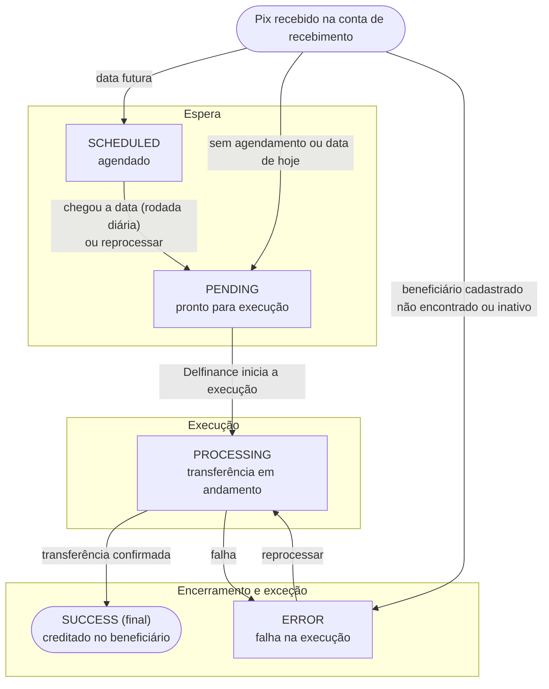
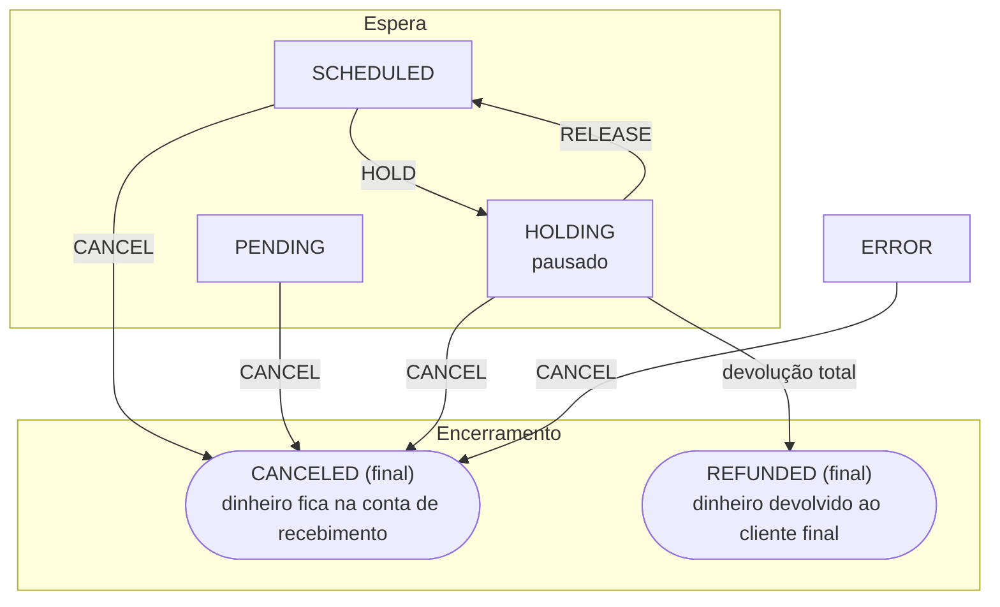

<Warning>
**Funcionalidade em beta.** As rotas, os campos e os status descritos aqui são uma proposta e podem mudar antes da versão final. Veja [Acompanhar repasses](/guias/split-pagamentos/acompanhar-repasses).
</Warning>

Cada pagamento recebido com split gera um **repasse** (*payout*) por instrução. O repasse passa por uma sequência de status até terminar: ele é concluído, cancelado ou devolvido ao cliente final.

Nesta página, você vê, para cada status:

- como o repasse entra nele e como sai;
- quem provoca a mudança: a Delfinance, o gestor do marketplace pela API ou a instituição do beneficiário;
- onde está o dinheiro;
- se o status é final.

O status vem no campo `status` do repasse, como enum (`name`, `description` e `value`). Use sempre o `name` na sua integração. Veja [Formato dos enums](/guias/split-pagamentos/acompanhar-repasses#formato-dos-enums).

## Visão geral

| Grupo | Status | O que significa |
|---|---|---|
| Espera | `SCHEDULED`, `PENDING`, `HOLDING` | O repasse ainda não foi executado. O dinheiro está na conta de recebimento |
| Execução | `PROCESSING` | A transferência para a conta do beneficiário está em andamento |
| Exceção | `ERROR` | A execução falhou. O dinheiro está na conta de recebimento, e o repasse pode ser reprocessado |
| Encerramento | `SUCCESS`, `CANCELED`, `REFUNDED` | Status finais. O repasse não muda mais |

## Ciclo de vida

O ciclo está dividido em dois diagramas, para evitar setas cruzadas. Nos diagramas, os status finais têm borda arredondada e a marca **(final)**.

### Agendamento, execução e reprocessamento



### Pausa, cancelamento e devolução



## Status e significados

| Status (`name`) | Significado | Onde está o dinheiro | Pode ir para | Final? |
|---|---|---|---|---|
| `SCHEDULED` | Repasse agendado para uma data futura, definida por `paymentDate` (data fixa) ou calculada por `daysUntilPayment` (dias após o pagamento) | Conta de recebimento | `PENDING`, `HOLDING`, `CANCELED` | Não |
| `PENDING` | Pronto para execução. Em geral, dura poucos segundos | Conta de recebimento | `PROCESSING`, `CANCELED` | Não |
| `HOLDING` | Pausado pelo gestor do marketplace, por exemplo, por uma disputa da venda. Não é executado, nem na data prevista. Dados da pausa em `holdDetails` | Conta de recebimento | `SCHEDULED`, `CANCELED`, `REFUNDED` | Não |
| `PROCESSING` | Transferência em andamento. Em `INTERNAL`, dura um instante. Em `PIX_MANUAL` e `PIX_KEY`, dura até a confirmação do Pix pela instituição do beneficiário | Saindo da conta de recebimento | `SUCCESS`, `ERROR` | Não |
| `SUCCESS` | Valor creditado na conta do beneficiário. Data em `paidAt` | Conta do beneficiário | — | Sim |
| `ERROR` | A execução falhou. Motivo em `errorMessage` | Conta de recebimento | `PROCESSING` (reprocessar), `CANCELED` | Não |
| `CANCELED` | Cancelado antes da execução. Dados em `cancellationDetails` | Conta de recebimento | — | Sim |
| `REFUNDED` | Todo o valor do repasse foi devolvido ao cliente final antes da execução | Conta do cliente final | — | Sim |

<Warning>
Não confunda `CANCELED` com `REFUNDED`. No cancelamento, o dinheiro **fica na conta de recebimento**. Na devolução, o dinheiro **sai da conta de recebimento** e volta ao cliente final por um Pix de devolução.
</Warning>

## Transições permitidas

Qualquer transição que não está nesta tabela não acontece. Se você pedir uma ação num status que não a aceita, a API recusa o pedido.

| De | Para | Gatilho | Quem provoca | Efeito no dinheiro |
|---|---|---|---|---|
| — | `PENDING` | Pix recebido, sem agendamento, com `daysUntilPayment` igual a `0` ou com `paymentDate` igual ou anterior à data do pagamento | Delfinance | Nenhum. O valor já está na conta de recebimento |
| — | `SCHEDULED` | Pix recebido, com data do repasse futura | Delfinance | Nenhum |
| — | `ERROR` | Pix recebido, mas o `beneficiaryId` da instrução não existe, é de outra conta de recebimento ou está inativo no [cadastro de beneficiários](/guias/split-pagamentos/beneficiarios) | Delfinance | Nenhum. O valor fica na conta de recebimento |
| `SCHEDULED` | `PENDING` | Chegou a data do repasse, na rodada diária de repasses agendados (6h, horário de Brasília) | Delfinance | Nenhum |
| `SCHEDULED` | `PENDING` | [Reprocessar repasse](/api-reference/split-pagamentos/reprocessar-repasses), que antecipa o repasse | Gestor do marketplace | Nenhum |
| `PENDING` | `PROCESSING` | Início da execução | Delfinance | A transferência começa a partir da conta de recebimento |
| `ERROR` | `PROCESSING` | [Reprocessar repasse](/api-reference/split-pagamentos/reprocessar-repasses) | Gestor do marketplace | A transferência começa de novo |
| `PROCESSING` | `SUCCESS` | Transferência concluída. Em `INTERNAL`, na hora. Em Pix, na confirmação da instituição do beneficiário | Delfinance ou instituição do beneficiário | O valor é creditado na conta do beneficiário |
| `PROCESSING` | `ERROR` | Falha na transferência. Por exemplo: saldo insuficiente, conta do beneficiário inexistente, Pix rejeitado, chave Pix inexistente ou de outro titular | Delfinance ou instituição do beneficiário | O valor fica, ou volta, na conta de recebimento |
| `SCHEDULED` | `HOLDING` | [Atualizar repasse](/api-reference/split-pagamentos/atualizar-repasse) com `HOLD` | Gestor do marketplace | Nenhum |
| `HOLDING` | `SCHEDULED` | [Atualizar repasse](/api-reference/split-pagamentos/atualizar-repasse) com `RELEASE`. Se a data já passou, o repasse sai na próxima rodada diária | Gestor do marketplace | Nenhum |
| `SCHEDULED`, `PENDING`, `HOLDING`, `ERROR` | `CANCELED` | [Atualizar repasse](/api-reference/split-pagamentos/atualizar-repasse) com `CANCEL` | Gestor do marketplace | Nenhum. O valor fica na conta de recebimento |
| `HOLDING` | `REFUNDED` | A última [devolução](/api-reference/split-pagamentos/devolver-repasse) é concluída, e o total devolvido chega ao valor original do repasse | Gestor do marketplace pede, Delfinance conclui | Cada devolução envia um Pix da conta de recebimento ao cliente final |

Algumas ações não mudam o status:

| Ação | Status aceitos | Efeito |
|---|---|---|
| Mudar a data (`paymentDate` em [Atualizar repasse](/api-reference/split-pagamentos/atualizar-repasse)) | `SCHEDULED`, `HOLDING` | Muda `paymentDate`. O status continua o mesmo |
| [Devolução](/api-reference/split-pagamentos/devolver-repasse) parcial | `HOLDING` | O `amount` do repasse diminui, e o `refundedAmount` aumenta. Um Pix de devolução sai da conta de recebimento para o cliente final |

## Regras de negócio

### Agendamento

- A data do repasse é definida na instrução de split do QR Code, por `daysUntilPayment` (dias corridos após o pagamento) ou por `paymentDate` (data fixa). Veja [Agendar um repasse](/guias/split-pagamentos/split-por-cobranca#agendar-um-repasse).
- A data calculada por `daysUntilPayment` aparece em `paymentDate` nas consultas.
- Os repasses agendados saem na rodada diária, às 6h (horário de Brasília), na data do repasse.
- O split padrão da conta não tem agendamento: os repasses nascem em `PENDING`.

### Pausa e liberação

- Só um repasse em `SCHEDULED` pode ser pausado (`HOLD`).
- Em `HOLDING`, o repasse não é executado, nem na data prevista. Você ainda pode mudar a data, devolver parte do valor ou cancelar.
- `RELEASE` devolve o repasse para `SCHEDULED`. Para liberar com uma nova data, envie `paymentDate` junto.

### Execução

| Forma de repasse | Como a execução acontece |
|---|---|
| `INTERNAL` | Transferência entre contas Delfinance. O repasse passa por `PROCESSING` por um instante e vai para `SUCCESS` |
| `PIX_MANUAL` | Pix para os dados bancários informados. Fica em `PROCESSING` até a instituição do beneficiário confirmar |
| `PIX_KEY` | A chave é consultada no DICT, e o titular precisa ter o mesmo documento de `holder.document`. Depois, é enviado um Pix, que fica em `PROCESSING` até a confirmação |

O valor só sai da conta de recebimento na execução. Mantenha saldo para os repasses agendados.

### Erros e reprocessamento

- Em `ERROR`, o motivo vem em `errorMessage`, e o valor fica na conta de recebimento.
- Depois de corrigir a causa, por exemplo, recompondo o saldo, [reprocesse o repasse](/api-reference/split-pagamentos/reprocessar-repasses). Ele volta para `PROCESSING`.
- Se a causa não puder ser corrigida, como uma conta do beneficiário encerrada, cancele o repasse. Os dados do beneficiário de um repasse já criado não podem ser alterados.
- Um repasse também pode nascer em `ERROR`, quando a instrução usa um `beneficiaryId` que não existe, é de outra conta de recebimento ou está inativo. Nesse caso, reprocessar não resolve: cancele o repasse.
- A falha de um repasse não afeta os outros repasses da mesma ordem de recebimento com split.

### Cancelamento

- É aceito em `SCHEDULED`, `PENDING`, `HOLDING` e `ERROR`, e é irreversível.
- O valor fica na conta de recebimento. Nenhum dinheiro é movimentado.
- `PENDING` costuma durar poucos segundos. Para ter tempo de cancelar, agende o repasse.

### Devolução integral

- A devolução envia um Pix de devolução do pagamento original ao cliente final, com o valor saindo da conta de recebimento, e desconta esse valor do repasse.
- Só é aceita em `HOLDING`. Para devolver, pause o repasse antes com `HOLD`, o que exige que ele esteja agendado (`SCHEDULED`). Depois de `SUCCESS`, o dinheiro já está com o beneficiário.
- O repasse vai para `REFUNDED` só quando o total devolvido chega ao valor original. Com devoluções parciais, ele continua em `HOLDING` e, depois de liberado com `RELEASE`, é executado com o valor restante.

## Campos relacionados ao status

| Campo | Quando vem preenchido |
|---|---|
| `status` | Sempre. Enum com `name`, `description` e `value` |
| `paymentDate` | Sempre. Data prevista do repasse, informada ou calculada |
| `paidAt` | Em `SUCCESS`. Data e hora da conclusão |
| `transactionId` | Depois que a transferência é criada |
| `endToEndId` | Em repasses por Pix (`PIX_MANUAL` e `PIX_KEY`), depois do envio |
| `errorMessage` | Em `ERROR`. Motivo da falha |
| `holdDetails` | Depois de uma pausa. Quem pausou, motivo e data, e os dados da liberação |
| `cancellationDetails` | Em `CANCELED`. Quem cancelou, motivo e data |
| `refundedAmount` | Sempre. Total devolvido ao cliente final (`0` sem devolução) |

Veja a estrutura completa do repasse em [Listar repasses](/api-reference/split-pagamentos/listar-repasses#response).

Exemplo de um repasse em `ERROR`, com os campos de status:

```json
{
    "id": "5d2e8f1a-7c3b-4e9d-a6f0-1b2c3d4e5f60",
    "status": {
        "name": "ERROR",
        "description": "Erro",
        "value": 2
    },
    "amount": 5.00,
    "refundedAmount": 0.00,
    "paymentDate": "2026-10-20",
    "transactionId": "c9d8e7f6-a5b4-4c3d-9e2f-1a0b9c8d7e6f",
    "endToEndId": "E00000000202610201015fedcba654321",
    "errorMessage": "Conta do beneficiário inexistente ou encerrada",
    "holdDetails": null,
    "cancellationDetails": null,
    "paidAt": null
}
```

## Exemplos de jornada

<AccordionGroup>
  <Accordion title="Repasse imediato para conta Delfinance">
    `PENDING` → `PROCESSING` → `SUCCESS`, em segundos, logo após o pagamento.
  </Accordion>
  <Accordion title="Repasse por Pix agendado para 30 dias">
    Instrução com `daysUntilPayment: 30` e `transferType: PIX_KEY`. O repasse nasce em `SCHEDULED`, com `paymentDate` igual ao dia do pagamento mais 30 dias. Na data, às 6h, vai para `PENDING` e depois para `PROCESSING`. Termina em `SUCCESS` quando o Pix é confirmado.
  </Accordion>
  <Accordion title="Disputa resolvida com devolução parcial">
    `SCHEDULED` → `HOLD` → `HOLDING`. Uma devolução de parte do valor diminui o `amount`, e o status continua `HOLDING`. Depois, `RELEASE` → `SCHEDULED`. Na data, o repasse é executado com o valor restante.
  </Accordion>
  <Accordion title="Venda desfeita por inteiro">
    Com o repasse em `HOLDING`, você pode cancelar (`CANCEL` → `CANCELED`, e o valor fica na conta de recebimento) ou devolver todo o valor ao cliente final (devolução total → `REFUNDED`).
  </Accordion>
  <Accordion title="Falha por saldo insuficiente">
    Na data, `PENDING` → `PROCESSING` → `ERROR`, com o motivo em `errorMessage`. Depois de recompor o saldo, reprocesse: `ERROR` → `PROCESSING` → `SUCCESS`.
  </Accordion>
</AccordionGroup>
