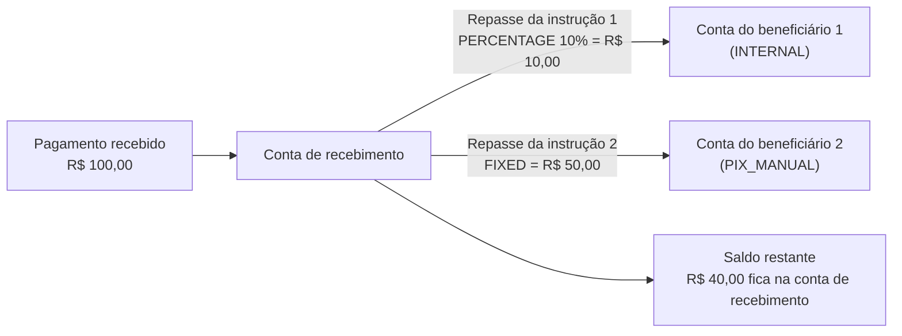

O Split de Pagamentos divide automaticamente os valores recebidos em uma conta Delfinance. Assim que um pagamento é creditado na **conta de recebimento**, a Delfinance calcula e transfere a parte de cada **beneficiário** para a conta dele, de acordo com as regras definidas. Sua aplicação não precisa fazer nada a cada recebimento.

<Tip>
Útil para marketplaces, plataformas de serviços e qualquer negócio que precise repassar parte de um recebimento para fornecedores, parceiros, afiliados ou franqueados sem processar isso manualmente.
</Tip>

## Conceitos

Toda a documentação de split usa os termos abaixo.

| Termo | O que é |
|---|---|
| **Conta de recebimento** | A conta Delfinance que recebe o pagamento original, com o valor integral. É dela que saem os repasses. No split padrão, é o `bankAccountNumber` da configuração. No split por cobrança, é a conta que cria o QR Code (header `x-delfinance-account-id`) |
| **Beneficiário** | A pessoa ou empresa que recebe uma parte do pagamento. Por exemplo: o vendedor, o parceiro ou o afiliado |
| **Conta do beneficiário** | A conta para onde a parte do beneficiário é transferida. Pode ser uma conta Delfinance (`INTERNAL`) ou uma conta em outra instituição (`PIX_MANUAL`). Os dados dela vão no objeto `beneficiary` |
| **Instrução** | A regra de um repasse: quanto sai (`amount`), como o valor é calculado (`type`: `PERCENTAGE` ou `FIXED`), por qual meio é enviado (`transferType`) e para quem (`beneficiary`) |
| **Repasse** | A transferência efetiva da conta de recebimento para a conta do beneficiário, gerada por uma instrução a cada pagamento recebido |

Um jeito simples de visualizar: um pagamento de R$ 100 chega na conta de recebimento, e cada instrução gera um repasse para a conta do beneficiário. O valor que não foi destinado a nenhuma instrução permanece na conta de recebimento.

Em um marketplace, por exemplo, o cliente paga o pedido inteiro na conta de recebimento da plataforma, e a parte do vendedor (o beneficiário) é repassada automaticamente para a conta dele, sem que a plataforma precise fazer essa transferência manualmente.

## Duas formas de usar o split

<CardGroup cols={2}>
  <Card title="Split padrão da conta" icon="gear" href="/guias/split-pagamentos/configurar">
    Uma regra configurada uma vez na conta e aplicada a **todos** os Pix recebidos nela. Ideal quando o repasse é sempre o mesmo, como a parte fixa de um parceiro.
  </Card>
  <Card title="Split por cobrança" icon="qrcode" href="/guias/split-pagamentos/split-por-cobranca">
    Regras definidas na criação de cada QR Code dinâmico, valendo só para aquela cobrança. Ideal quando cada venda tem um destinatário diferente, como em um marketplace.
  </Card>
</CardGroup>

As duas formas usam as mesmas instruções: quanto repassar (`amount` + `type`), como o repasse é feito (`transferType`) e para quem (`beneficiary`). Quando uma cobrança traz o próprio split, ele **substitui** o split padrão da conta para os pagamentos daquele QR Code.

O restante desta página descreve o split padrão da conta. Para o split por cobrança, veja [Split por cobrança (QR Code)](/guias/split-pagamentos/split-por-cobranca).

## Como funciona o split padrão da conta

1. Você cria uma **configuração de split padrão** para a conta de recebimento (`bankAccountNumber`).
2. Na configuração, você cadastra uma ou mais **instruções** (`instructions`), uma para cada beneficiário.
3. A partir daí, todo pagamento Pix recebido na conta de recebimento gera os repasses automaticamente, conforme as instruções vigentes no momento do recebimento. A exceção são os pagamentos de cobranças com split próprio.

## Tipos de instrução (`type`)

<CardGroup cols={2}>
  <Card title="PERCENTAGE" icon="percent">
    O valor repassado é calculado como uma porcentagem do valor total do pagamento. A porcentagem máxima permitida **por instrução** é de **5%**.
  </Card>
  <Card title="FIXED" icon="hashtag">
    O valor repassado é um valor absoluto e fixo, independente do valor do pagamento recebido. Se o valor definido exceder **50%** do valor da transação, o split não é executado para aquela instrução naquele pagamento.
  </Card>
</CardGroup>

<Warning>
Esses limites são validados a cada transação recebida, não apenas na criação da configuração. Um `amount` fixo que hoje representa menos de 50% do valor médio recebido pode ultrapassar esse limite em um pagamento de valor menor. Nesse caso, o split daquela instrução simplesmente não é aplicado naquela transação.
</Warning>

## Formas de repasse (`transferType`)

O campo `transferType` define por qual meio o beneficiário recebe o valor. Cada opção tem um comportamento e um nível de validação diferente.

| `transferType` | Situação atual |
|---|---|
| `INTERNAL` | Suportado. Repasse entre contas da mesma titularidade (mesmo dono da API key). |
| `PIX_MANUAL` | Suportado. Repasse via dados bancários informados manualmente, com validação completa. |
| `EXTERNAL` | Aceito pela API, mas ainda sem validação específica dos dados bancários. Não recomendado para produção. |
| `PIX_KEY` | Ainda não funcional nesta rota. Não utilize até que o suporte seja anunciado. |

<Warning>
Hoje, use apenas `INTERNAL` e `PIX_MANUAL` em produção. Veja os detalhes e exemplos de cada tipo no guia [Configurar o split padrão da conta](/guias/split-pagamentos/configurar).
</Warning>

## Estrutura de dados

### Configuração do split padrão

| Campo | Tipo | Descrição |
|---|---|---|
| `id` | `number` | Identificador único da configuração |
| `bankAccountNumber` | `string` | Conta onde os pagamentos são recebidos e divididos |
| `instructions` | `array` | Lista de instruções de repasse |
| `createdAt` | `string` | Data/hora de criação em ISO 8601 |
| `updatedAt` | `string` | Data/hora da última atualização em ISO 8601 |

### Instrução

| Campo | Tipo | Descrição |
|---|---|---|
| `id` | `number` | Identificador único da instrução dentro da configuração |
| `splitPaymentConfigurationId` | `number` | Configuração à qual a instrução pertence |
| `amount` | `number` | Valor a aplicar, conforme o `type` |
| `type` | `enum` | `PERCENTAGE` ou `FIXED` |
| `transferType` | `enum` | `INTERNAL`, `PIX_MANUAL`, `EXTERNAL` ou `PIX_KEY` |
| `beneficiary` | `object` | Dados da conta do beneficiário, descritos abaixo |

### Beneficiário (`beneficiary`)

| Campo | Tipo | Descrição |
|---|---|---|
| `number` | `string` | Número da conta do beneficiário (2 a 25 caracteres) |
| `branch` | `string` | Agência da conta do beneficiário (1 a 10 caracteres) |
| `participantIspb` | `string` | ISPB da instituição de destino (8 caracteres) |
| `type` | `enum` | Tipo da conta do beneficiário: `PAYMENT`, `CURRENT` ou `SAVING` |
| `holder` | `object` | Dados do titular da conta do beneficiário |

### Titular (`holder`)

| Campo | Tipo | Descrição |
|---|---|---|
| `document` | `string` | CPF ou CNPJ do titular |
| `name` | `string` | Nome do titular (1 a 100 caracteres) |
| `email` | `string` | E-mail do titular (opcional) |
| `phoneNumber` | `string` | Telefone do titular (opcional) |
| `type` | `enum` | Tipo do titular: `NATURAL` ou `LEGAL` (opcional) |

## Próximos passos

<Tip>
Vai montar um marketplace? Veja a jornada completa, do checkout à área do vendedor, no [guia para marketplaces](/guias/split-pagamentos/marketplace).
</Tip>

<CardGroup cols={2}>
  <Card title="Configurar split padrão" icon="gear" href="/guias/split-pagamentos/configurar">
    Crie uma configuração de split e cadastre ou atualize instruções, por tipo de repasse.
  </Card>
  <Card title="Split por cobrança" icon="qrcode" href="/guias/split-pagamentos/split-por-cobranca">
    Defina o split de cada cobrança na criação do QR Code dinâmico.
  </Card>
  <Card title="Consultar split padrão" icon="magnifying-glass" href="/guias/split-pagamentos/consultar">
    Liste todas as configurações ou consulte uma configuração específica por ID.
  </Card>
  <Card title="Remover split padrão" icon="trash" href="/guias/split-pagamentos/remover">
    Remova uma configuração inteira ou apenas uma instrução específica.
  </Card>
</CardGroup>
