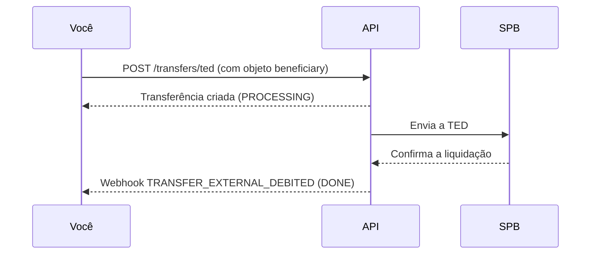

A TED (Transferência Eletrônica Disponível) envia dinheiro da sua conta Delfinance para uma conta em outra instituição financeira. Você informa os dados bancários do recebedor e a transferência é liquidada pelo SPB (Sistema de Pagamentos Brasileiro).

O envio é feito em uma única chamada ao endpoint `POST /transfers/ted`. Não há etapa de inicialização.

## Quando usar TED

| | TED | Pix por dados bancários |
|---|---|---|
| Sistema de liquidação | SPB | SPI (Pix) |
| Janela de processamento | Dias úteis, até 17h (horário de Brasília) | 24 horas, todos os dias |
| Tempo de liquidação | Após confirmação do SPB | Instantâneo |
| Endpoint | `POST /transfers/ted` | `POST /transfers` |

<Tip>
Se a instituição destino aceita Pix, prefira [Pagar via Pix por dados bancários](/guias/pix/pagar-pix/por-dados-bancarios). Use TED quando o destino não aceita Pix ou quando o seu processo exige TED.
</Tip>

## Como funciona o fluxo

<Warning>
A resposta do `POST /transfers/ted` indica que a TED foi **enfileirada**, não que já foi liquidada. A confirmação chega via webhook. Não use polling como mecanismo principal de confirmação.
</Warning>

## Status da TED

| Status | Significado |
|---|---|
| `PROCESSING` | TED recebida e aguardando confirmação do SPB |
| `DONE` | TED confirmada pelo SPB e liquidada |
| `CHARGEBACKED` | TED devolvida pela instituição destino |

<Note>
Uma TED com status `DONE` ainda pode ser devolvida pela instituição destino — por exemplo, quando a conta não existe ou o documento do titular não confere. Nesse caso, o status muda para `CHARGEBACKED`.
</Note>

## Próximos passos

<CardGroup cols={2}>
  <Card title="Enviar TED" icon="paper-plane" href="/guias/ted/pagar-ted/enviar-ted">
    Envie uma TED informando os dados bancários do recebedor.
  </Card>
  <Card title="Consultar pagamento" icon="magnifying-glass" href="/guias/ted/pagar-ted/consultar-pagamento">
    Consulte o status de uma TED enviada.
  </Card>
</CardGroup>
