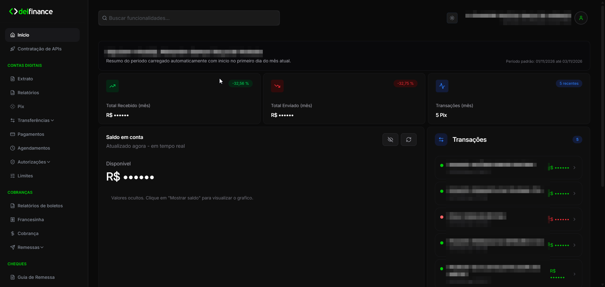
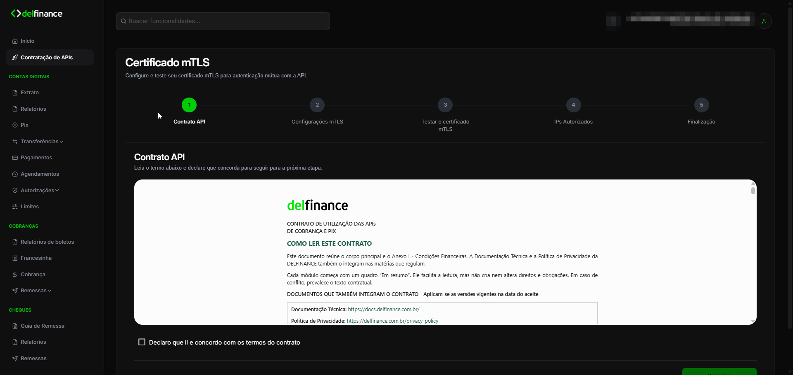
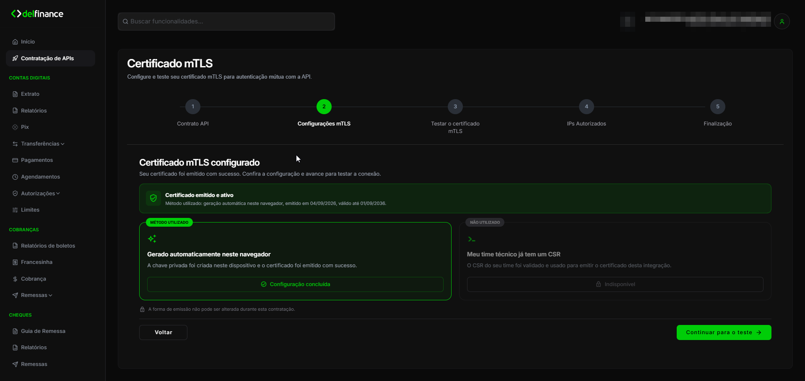
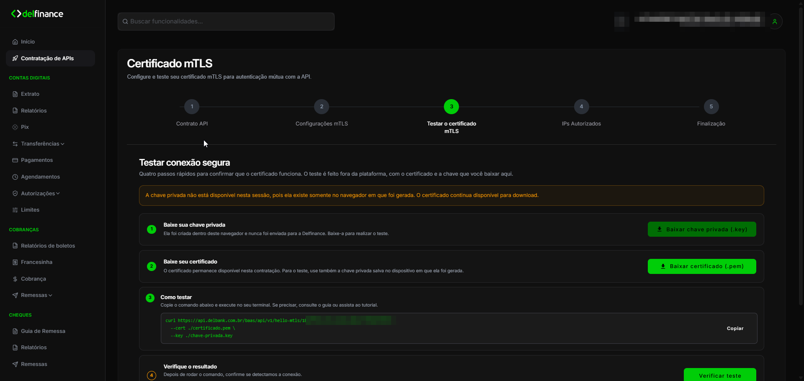
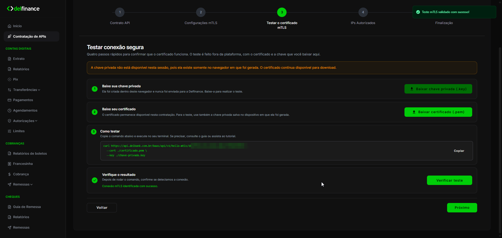
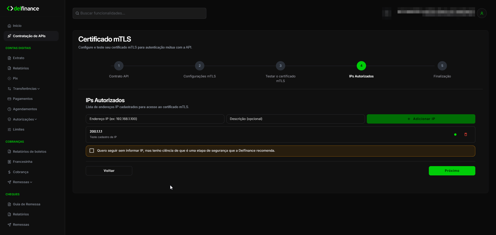
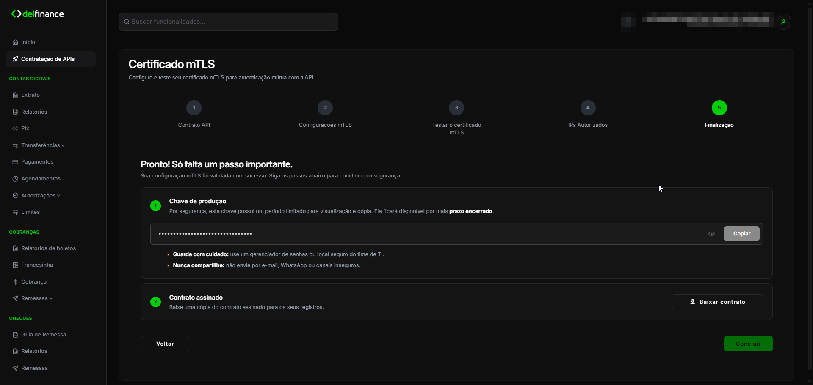
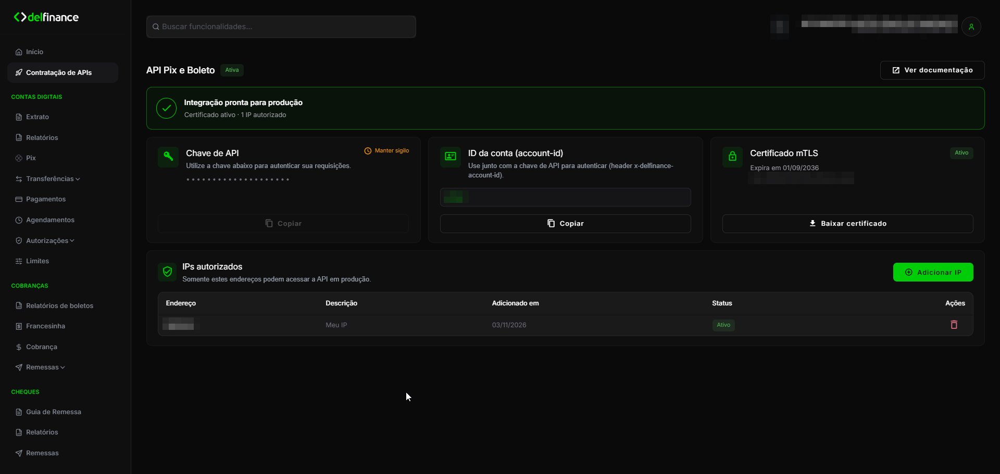

A contratação da API é feita no internet banking da conta Delfinance que vai usar a integração. Ao final, você tem tudo o que precisa para chamar a API em Produção:

- **chave de API**, enviada no header `x-delbank-api-key`;
- **ID da conta (account-id)**, enviado no header `x-delfinance-account-id`;
- **certificado mTLS** (`.pem`) e a **chave privada** (`.key`);
- **IPs autorizados** a acessar a API.

<Note>
  Tudo o que é gerado nesse fluxo vale para **Produção**. Para testar antes de contratar, use as [chaves de teste do Sandbox](/autenticacao/chaves-teste).
</Note>

## Antes de começar

- Tenha acesso ao internet banking da conta que vai usar a API.
- Faça a contratação no mesmo navegador do início ao fim. Se você escolher gerar o certificado no navegador, a chave privada fica só nele.
- Tenha um terminal com `curl` para testar o certificado.
- Separe os IPs públicos de saída dos servidores que vão chamar a API. Veja [Filtros de IPs](/autenticacao/filtros-ip).

## Passo a passo

<Steps>
  <Step title="Acesse Contratação de APIs">
    No internet banking, clique em **Contratação de APIs** no menu lateral.

    
  </Step>
  <Step title="Aceite o contrato">
    Leia o contrato de utilização das APIs. Marque **Declaro que li e concordo com os termos do contrato** e avance.

    
  </Step>
  <Step title="Configure o certificado mTLS">
    Escolha como o certificado será emitido:

    - **Gerado automaticamente neste navegador**: o internet banking cria a chave privada no seu navegador e emite o certificado. A chave privada não é enviada à Delfinance.
    - **Meu time técnico já tem um CSR**: você envia um CSR gerado pelo seu time. Veja como gerar em [Gerando o CSR com OpenSSL](/autenticacao/mtls#gerando-o-csr-com-openssl).

    

    <Warning>
      A forma de emissão não pode ser alterada durante a contratação.
    </Warning>

    Com o certificado emitido, clique em **Continuar para o teste**.
  </Step>
  <Step title="Teste o certificado">
    Nesta etapa, você testa a conexão mTLS fora do internet banking:

    1. Clique em **Baixar chave privada (.key)**. Só aparece se o certificado foi gerado no navegador.
    2. Clique em **Baixar certificado (.pem)**.
    3. Copie o comando `curl` exibido e execute no seu terminal, na pasta onde estão os dois arquivos. A URL do `hello-mtls` é exclusiva do seu certificado.
    4. Clique em **Verificar teste**.

    

    <Warning>
      A chave privada gerada no navegador existe somente nele. Baixe o arquivo `.key` nesta etapa e guarde em local seguro. Em outro navegador ou em outra sessão, ela não fica disponível para download.
    </Warning>

    Quando a conexão for identificada, o internet banking exibe **Conexão mTLS identificada com sucesso**. Clique em **Próximo**.

    
  </Step>
  <Step title="Informe os IPs autorizados">
    Informe o **Endereço IP** de cada servidor que vai chamar a API e, se quiser, uma **Descrição**. Clique em **Adicionar IP** para cada um.

    

    A Delfinance recomenda cadastrar os IPs. Se preferir dispensar a allowlist, marque **Quero seguir sem informar IP, mas tenho ciência de que é uma etapa de segurança que a Delfinance recomenda**. Ao dispensar, requisições autenticadas passam a ser aceitas de qualquer IP. Veja o que muda em [Dispensa da allowlist](/autenticacao/filtros-ip#dispensa-da-allowlist).
  </Step>
  <Step title="Copie a chave de API">
    Na finalização, o internet banking exibe a **Chave de produção**. Copie e guarde a chave em um gerenciador de senhas ou cofre de segredos.

    

    <Warning>
      Por segurança, a chave fica disponível para visualização e cópia por tempo limitado. Copie antes de concluir e nunca compartilhe a chave por e-mail, WhatsApp ou outros canais inseguros.
    </Warning>

    Se quiser, clique em **Baixar contrato** para guardar uma cópia do contrato assinado. Depois, clique em **Concluir**.
  </Step>
</Steps>

## Depois da contratação

Ao acessar **Contratação de APIs** de novo, você vê a tela da API contratada, com:

- **Chave de API**: exibida mascarada;
- **ID da conta (account-id)**: valor do header `x-delfinance-account-id`, com botão para copiar;
- **Certificado mTLS**: status, data de expiração e o botão **Baixar certificado**;
- **IPs autorizados**: lista de IPs, com opção de adicionar e remover. Você pode ativar ou dispensar a allowlist a qualquer momento. Adicionar um IP ativa o filtro. Veja [Dispensa da allowlist](/autenticacao/filtros-ip#dispensa-da-allowlist).

## Próximos passos

<CardGroup cols={2}>
  <Card title="Exemplos de conexão" icon="code" href="/autenticacao/exemplos-conexao">
    Monte o cliente HTTP com o certificado e os headers na sua linguagem.
  </Card>
  <Card title="mTLS" icon="lock" href="/autenticacao/mtls">
    Entenda o certificado, como gerar um CSR e os erros mais comuns.
  </Card>
</CardGroup>
